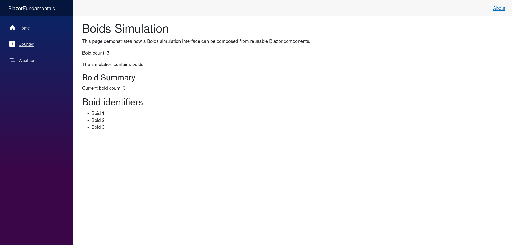

# Blazor Fundamentals

## Micro Goal

Understand how Blazor applications are structured, how Razor components combine C# and HTML, how components render UI, and how static rendering differs from interactive rendering in modern Blazor applications.

## Concepts Covered

- What Blazor is and where it fits in .NET web development
- Razor components and `.razor` files
- HTML markup and C# expressions
- Razor directives and code blocks
- Component structure and composition
- `Program.cs` and application startup
- The `App.razor` component and application routing structure
- Component rendering and re-rendering
- Component parameters and basic component reuse
- Static server-side rendering
- Interactive Server, Interactive WebAssembly, and Interactive Auto render modes
- The relationship between render modes and execution location
- The role of `@rendermode`
- Development and execution using the .NET CLI
- The difference between UI rendering and application state
- Basic browser developer tools and troubleshooting

## Completion Criteria

- [ ] Explain what Blazor is and how it uses C# to build web interfaces.
- [ ] Identify the purpose of `.razor`, `Program.cs`, and `App.razor`.
- [ ] Create a Razor component containing HTML and C# expressions.
- [ ] Use the `@` syntax to display values and evaluate expressions.
- [ ] Explain how a component's markup is rendered into browser-visible UI.
- [ ] Create and render a reusable component.
- [ ] Explain the difference between static server-side rendering and interactive rendering.
- [ ] Identify the main Blazor render modes and their execution locations.
- [ ] Explain why a visible button is not necessarily interactive.
- [ ] Create and run a Blazor application using the .NET CLI.
- [ ] Explain why rendering a component is different from synchronizing its state across users.

## Lecture

### 1. What Blazor is

Blazor is a .NET web UI framework that lets developers build interactive web interfaces using C#, Razor, and HTML. Rather than implementing all UI behavior in JavaScript, you can use C# components to describe the interface and respond to events.

A Blazor application can contain pages, reusable UI components, forms, controls, and application logic. Components can receive data, render HTML, respond to user actions, and coordinate with other components.

For the Boids simulation, Blazor will provide the browser interface. It can display the simulation, expose controls for changing parameters, and present information about the current state.

Blazor is part of ASP.NET Core, but it is not itself a database or a real-time synchronization system. It provides the UI framework. HTTP APIs, persistence, authentication, and real-time communication can be integrated as the application develops.

### 2. Razor components and `.razor` files

A Razor component is a file that combines HTML markup with C# syntax. Blazor components typically use the `.razor` extension.

For example, a component named `Welcome.razor` can contain:

```razor
<h1>Welcome to Blazor</h1>

<p>This page is rendered by a Razor component.</p>
```

The HTML describes the structure of the interface. Blazor processes the component and renders the resulting UI through the configured rendering model.

A component can also include C# expressions:

```razor
<h1>Hello, @userName</h1>

@code {
    private string userName = "Developer";
}
```

The `@` symbol transitions from markup into C# syntax. Here, `@userName` evaluates the C# field and displays its value in the rendered output.

A `.razor` file is not simply an HTML file with arbitrary C# inserted into it. Razor has defined rules for parsing markup, expressions, directives, and code blocks.

### 3. C# expressions and code blocks

Razor allows C# expressions to appear within markup. An expression is evaluated and its result can be rendered as text or used in an attribute.

```razor
<p>Current speed: @speed</p>

<p>Double the speed: @(speed * 2)</p>

@code {
    private double speed = 2.5;
}
```

The first expression renders the value of `speed`. The second uses parentheses to make the complete C# expression explicit.

The `@code` block contains the component's C# members. These can include fields, properties, methods, and other supported member declarations.

For example:

```razor
<p>Boid count: @boidCount</p>

@code {
    private int boidCount = 100;

    private string GetSimulationDescription()
    {
        return $"Simulating {boidCount} boids.";
    }
}
```

You can call a method from markup:

```razor
<p>@GetSimulationDescription()</p>
```

Use code blocks for component logic and expressions for displaying or evaluating values in markup. As components grow, move substantial business logic into separate classes or services rather than making the Razor file responsible for everything.

### 4. Conditional and repeated markup

Razor supports conditional rendering and iteration. These are useful when the interface depends on data.

An `@if` block can determine which markup appears:

```razor
@if (boidCount > 0)
{
    <p>The simulation contains boids.</p>
}
else
{
    <p>The simulation is empty.</p>
}
```

A `foreach` loop can render a collection:

```razor
<ul>
    @foreach (string name in boidNames)
    {
        <li>@name</li>
    }
</ul>

@code {
    private List<string> boidNames = new()
    {
        "Boid 1",
        "Boid 2",
        "Boid 3"
    };
}
```

Blazor evaluates the component's markup and renders the elements produced by these constructs.

In larger dynamic lists, the `@key` directive can help Blazor associate rendered elements with the correct items when the collection changes:

```razor
<ul>
    @foreach (string name in boidNames)
    {
        <li @key="name">@name</li>
    }
</ul>
```

A key should uniquely identify an item within the rendered collection. For the simple example, the names are unique. In a real simulation, a stable boid identifier would generally be a better key than a mutable display label.

### 5. The structure of a Blazor application

A Blazor application contains more than Razor components. Several files and directories work together to configure startup, routing, layout, and component rendering.

A modern Blazor Web App commonly includes files and directories similar to these:

```text
BoidsApp/
├── Components/
│   ├── App.razor
│   ├── Routes.razor
│   ├── Layout/
│   └── Pages/
├── wwwroot/
├── Program.cs
└── BoidsApp.csproj
```

The exact structure varies with the template and .NET version. Some templates include additional files for error handling, imports, or static assets.

Important parts include:

- `Program.cs` configures services, application startup, middleware, and the Blazor component endpoints.
- `App.razor` provides the root HTML document and establishes the application's top-level component structure in common Blazor Web App templates.
- `Routes.razor` typically connects URL routing to page components.
- `Components/Pages/` contains routeable page components in the common template structure.
- `Components/Layout/` contains layout components that provide shared page structure.
- `wwwroot/` contains static web assets such as CSS, images, and JavaScript.
- The `.csproj` file specifies the project configuration and dependencies.

These roles are related but distinct. `App.razor` is a component, `Program.cs` is the application entry point, and `Routes.razor` handles the component-level routing structure in templates that use it.

Do not assume every Blazor application has exactly this layout. The template determines the initial structure, and applications can organize their components differently.

### 6. Creating and running a Blazor Web App

The .NET CLI can create a Blazor Web App:

```bash
dotnet new blazor -n BlazorFundamentals
```

Move into the new directory and run it:

```bash
cd BlazorFundamentals
dotnet run
```

The application will print its local listening address. Open that address in a browser to inspect the generated application.

If you create the project in a learning repository, keep the project inside the corresponding numbered learning directory. For example, the module folder `01-BlazorFundamentals` can contain a project named `01-BlazorFundamentals`.

A basic project creation sequence from the repository root could look like this:

```bash
dotnet new blazor \
  -n 01-BlazorFundamentals \
  -o 04-blazor/01-BlazorFundamentals/01-BlazorFundamentals
```

This creates the project in a nested directory. If you prefer the `.csproj` directly inside the learning area's folder, use that folder as the output directory instead. Choose one structure and keep it consistent with the repository's conventions.

The `dotnet run` command builds the project if needed and launches it. The console output identifies the address to visit. Stop the running application with `Ctrl+C`.

### 7. Pages, routing, and layouts

A page is a component associated with a URL. In a typical Blazor Web App, a page declares its route using the `@page` directive.

For example, a `Pages/Simulation.razor` component might contain:

```razor
@page "/simulation"

<h1>Boids Simulation</h1>

<p>This page will host the simulation interface.</p>
```

When the application's router is configured, navigating to `/simulation` selects this component.

A layout defines the common structure shared by multiple pages, such as a navigation menu, header, or main content area. A page can render inside a layout so that shared UI does not need to be duplicated.

Routing and layouts will be studied in more detail in the dedicated Routing & Layouts module. Here, the key concept is that a Blazor application is composed of components, and page components are selected through routing.

### 8. Component composition and reuse

Components can contain other components. This allows an interface to be divided into smaller pieces, each with a clear responsibility.

Suppose `BoidSummary.razor` contains:

```razor
<h3>Boid Summary</h3>

<p>Count: @Count</p>

@code {
    [Parameter]
    public int Count { get; set; }
}
```

The `[Parameter]` attribute marks a property that can receive a value from a parent component.

A parent component can use it like this:

```razor
<BoidSummary Count="100" />
```

The parent supplies `100` as the component's `Count` parameter. The child component renders that value.

A component can be reused with different inputs:

```razor
<BoidSummary Count="100" />
<BoidSummary Count="250" />
```

These instances use the same component definition but receive different parameter values.

Parameters provide a basic way to pass data down a component hierarchy. More complex communication patterns, including callbacks and shared state, will be covered in the Events & Data Binding and State Management & Services modules.

### 9. What rendering means

Rendering is the process by which Blazor turns component state and markup into browser-visible UI.

When a component is rendered, Blazor evaluates its markup and expressions and produces the output appropriate for the application's rendering mode. In interactive scenarios, Blazor can render again when relevant component state changes.

For example, a component might display a boid count:

```razor
<p>Boids: @boidCount</p>

@code {
    private int boidCount = 100;
}
```

The rendered output initially displays `Boids: 100`.

Changing a field in code does not universally mean that the browser will immediately display a new value. The component must participate in an appropriate rendering cycle. In a normal event handler, Blazor usually schedules a re-render after the event is processed. State changes occurring outside the normal event flow may require explicit notification.

The Events & Data Binding module will cover this in detail. For now, distinguish between the component's C# state and the UI produced from that state.

### 10. Static server-side rendering

A Blazor Web App can render components on the server and return HTML to the browser without establishing an interactive Blazor session for that component.

This is known as static server-side rendering (static SSR).

In static SSR, the server evaluates the component and sends HTML to the browser. The browser can display the result, but ordinary Blazor component event handlers do not become interactive simply because the HTML was rendered.

For example, a static page may show a button:

```razor
<button @onclick="Increment">Increment</button>

<p>Count: @count</p>

@code {
    private int count;

    private void Increment()
    {
        count++;
    }
}
```

If this component is rendered statically without an interactive render mode, the button does not execute the Blazor `Increment` handler in response to a browser click. The markup exists, but the component is not running as an interactive Blazor component for that page.

Static SSR can be useful for content that does not require interactive component behavior. It can return HTML quickly and avoid maintaining an interactive connection for content that does not need one.

### 11. Interactive render modes

Interactive rendering enables components to respond to user events and update their UI through Blazor's component model.

Modern Blazor Web Apps support several interactive render modes:

- **Interactive Server:** Component interaction is processed on the server. Browser events and UI updates travel over a persistent SignalR connection.
- **Interactive WebAssembly:** Component code executes in the browser on the .NET WebAssembly runtime.
- **Interactive Auto:** Blazor can use server-side interactivity initially and WebAssembly interactivity on later visits when the required client assets have been downloaded. It is not a guarantee that every component instantly switches execution location.

A render mode determines how a component becomes interactive and where its component logic executes. It affects deployment, latency, resource usage, and how the browser communicates with the application.

For example, a component can explicitly request Interactive Server rendering:

```razor
@rendermode InteractiveServer

<button @onclick="Increment">Increment</button>

<p>Count: @count</p>

@code {
    private int count;

    private void Increment()
    {
        count++;
    }
}
```

The application must also register the relevant interactive services and endpoints in `Program.cs`. The default template can provide the necessary configuration, but if you add a render mode manually to an otherwise unconfigured project, the application setup must be updated accordingly.

Interactive WebAssembly and Interactive Auto have their own configuration requirements. They should be introduced deliberately rather than enabled indiscriminately throughout an application.

For this module, the key distinction is that **static rendering produces HTML, while interactive rendering enables component event handling and interactive UI updates**.

### 12. Where component code executes

Blazor's rendering mode determines where component code executes.

With Interactive Server, component logic runs on the server. Browser events are transmitted to the server, component state is updated there, and UI changes are sent back to the browser.

With Interactive WebAssembly, component logic executes in the browser. The browser runs .NET code through WebAssembly, and the application can update the UI without sending each component event to the server.

Interactive Auto can use both approaches depending on the application's configured behavior and whether the required WebAssembly assets are available.

These execution models have different trade-offs:

- Server interactivity keeps application execution on the server but requires a reliable connection for interactive events.
- WebAssembly interactivity executes component logic in the browser but requires the client runtime and application assets to be downloaded.
- Auto can offer flexibility but adds architectural and deployment considerations.

Neither model automatically synchronizes arbitrary application state across multiple users. For example, if two users open the same Boids page, their component instances do not automatically share their in-memory fields. Shared real-time simulation state will require an explicit communication and synchronization design in a later learning area.

### 13. The relationship between components and state

A component can maintain local state, such as a count or a selected display option. That state belongs to a component instance unless it is deliberately shared through another mechanism.

For example:

```razor
<p>Display mode: @displayMode</p>

@code {
    private string displayMode = "All Boids";
}
```

This field belongs to the component instance. It is not automatically saved to a database, synchronized across browsers, or shared with other users.

State can later be shared between components through services or other state-management patterns. It can be persisted in browser storage or a database. Real-time state can be distributed to multiple clients through a server-side communication mechanism.

Those are separate concerns from rendering. Blazor gives you the component framework, but you must decide where state lives, how long it lasts, who can access it, and how changes are communicated.

For the Boids simulation, the initial goal is to understand components and rendering before implementing shared state or real-time communication.

### 14. Basic troubleshooting

When a Blazor component does not behave as expected, inspect the following:

- **The component is not found:** Check the filename, namespace, imports, and where the component is referenced.
- **A route does not work:** Check the `@page` directive and the application's routing configuration.
- **A value is not displayed:** Check the C# expression and whether the component has the expected state.
- **A button does not respond:** Check whether the component is interactive and whether the event handler is correctly declared.
- **The application fails to start:** Inspect the terminal output for build errors, missing configuration, or startup exceptions.
- **The browser shows an error:** Inspect the browser console and the server logs, as appropriate for the rendering mode.

The terminal and browser developer tools provide complementary information. The terminal shows build and server-side errors; the browser shows client-side errors and network activity.

## Challenge

Create a small Blazor application that demonstrates component structure, Razor syntax, reusable components, and rendering behavior.

Your application must satisfy all of the following requirements:

1. **Create a Blazor Web App:** Generate and run a project using the .NET CLI.
2. **Create a page:** Add a routeable page at `/simulation` with a heading and a short description of the Boids simulation.
3. **Use Razor expressions:** Display a simulation name and a boid count from C# state.
4. **Use conditional markup:** Display one message when the boid count is greater than zero and another when it is zero.
5. **Render a collection:** Store several boid identifiers in a collection and display them with a `foreach` loop.
6. **Create a reusable component:** Implement a `BoidSummary` component that accepts a count through a `[Parameter]` property and displays it.
7. **Compose components:** Use `BoidSummary` from the simulation page and pass it a count.
8. **Understand rendering modes:** Identify whether your page is statically rendered or interactive in the generated application. Explain why the presence of a button alone does not guarantee that its Blazor event handler will execute.
9. **Inspect the project:** Identify the roles of `Program.cs`, `App.razor`, the routing component, the page component, and the `.csproj` file in your project.
10. **Run and verify:** Start the application, navigate to `/simulation`, and confirm that the page and reusable component render as expected.
11. **Keep the implementation focused:** Use clear component names and straightforward C# logic. Do not implement persistence, authentication, or multi-user synchronization in this module.

The goal is to understand how a Blazor application is assembled from components and how C# state becomes rendered UI. Interactive event handling and shared application state will be addressed in later modules.


