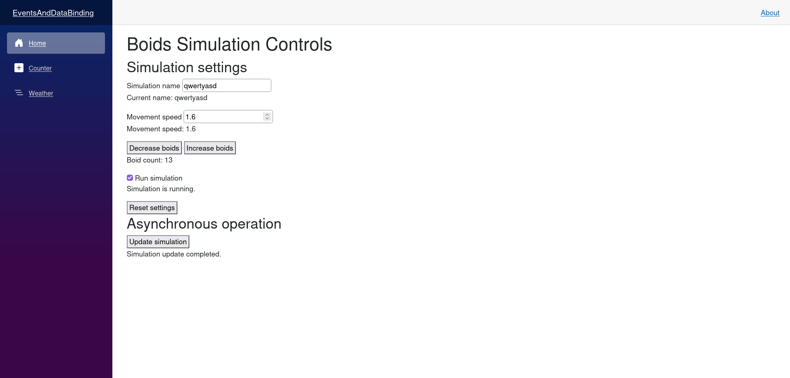

# Events & Data Binding

## Micro Goal

Understand how Blazor components respond to user interactions, update component state, and keep the rendered interface synchronized with C# properties through event handlers and data binding.

## Concepts Covered

- Blazor event handling
- Event directives such as `@onclick` and `@onchange`
- Event handler methods and lambda expressions
- Passing arguments to event handlers
- Component state and automatic rendering
- One-way data binding
- Two-way data binding with `@bind`
- Binding input elements to C# properties
- Binding event modifiers such as `@bind:event`
- Handling checkbox, text, and numeric inputs
- Event callbacks and `EventCallback<T>`
- Parent-to-child parameter flow and child-to-parent notifications
- Preventing default browser behavior and stopping event propagation
- Asynchronous event handlers
- Basic event-driven UI design

## Completion Criteria

- [ ] Handle user interactions with Blazor event directives.
- [ ] Use a C# method as an event handler.
- [ ] Pass values from a component into an event handler.
- [ ] Explain how changing component state causes the UI to update.
- [ ] Use `@bind` to synchronize an input and a C# property.
- [ ] Distinguish one-way binding from two-way binding.
- [ ] Bind text, numeric, and checkbox inputs.
- [ ] Use `EventCallback<T>` to notify a parent component of a child interaction.
- [ ] Explain when an event handler should be asynchronous.
- [ ] Use event modifiers when browser default behavior or event propagation needs to change.
- [ ] Build an interactive component that updates its state without manually manipulating the DOM.

## Lecture

### 1. Events make Blazor components interactive

A Razor component can render HTML and display values from C# code. To make the component interactive, it must respond to user actions such as clicking a button, entering text, checking a box, or selecting an option.

Blazor uses event directives to connect browser events to C# event handlers.

For example, a button can invoke a C# method when clicked:

```razor
<button @onclick="Increment">Increment</button>

<p>Count: @count</p>

@code {
    private int count;

    private void Increment()
    {
        count++;
    }
}
```

The `@onclick` directive tells Blazor to invoke `Increment` when the button is clicked. The method changes the component's `count` field. Blazor then renders the updated value, so the displayed count increases.

The important concept is that you update the component's C# state, not the HTML directly. Blazor handles synchronizing the rendered output with that state.

### 2. Event handler methods

An event handler is a method that runs in response to an event. A synchronous event handler can return `void`, while an asynchronous event handler commonly returns `Task`.

```razor
<button @onclick="Reset">Reset</button>
<button @onclick="SetMaximum">Set Maximum</button>

<p>Count: @count</p>

@code {
    private int count = 10;

    private void Reset()
    {
        count = 0;
    }

    private void SetMaximum()
    {
        count = 100;
    }
}
```

Each button invokes a different method. Both methods update the same component state, and Blazor refreshes the relevant rendered output after handling the event.

Event handlers can also be expressed with lambda expressions:

```razor
<button @onclick="() => count += 5">Add five</button>
```

This is useful for short operations. For more complex behavior, a named method is generally easier to read, test, and maintain.

Avoid placing large amounts of application logic inside Razor markup. Keep event handlers focused on coordinating actions and updating state, and move reusable or complex logic into methods or services.

### 3. Passing arguments to event handlers

Sometimes an event handler needs to know which item the user interacted with. A lambda expression can capture a value and pass it to a method.

```razor
<button @onclick="() => SelectBoid(1)">Select Boid 1</button>
<button @onclick="() => SelectBoid(2)">Select Boid 2</button>

<p>Selected boid: @selectedBoidId</p>

@code {
    private int? selectedBoidId;

    private void SelectBoid(int id)
    {
        selectedBoidId = id;
    }
}
```

The nullable integer `int?` allows the selection to be absent initially. Once a button is clicked, the selected identifier is assigned.

For a collection, the same pattern can be used to pass an item's identifier:

```razor
@foreach (var boid in boids)
{
    <button @onclick="() => SelectBoid(boid.Id)">
        Select @boid.Id
    </button>
}
```

The lambda captures the identifier for the corresponding item. This lets a single handler operate on different objects without writing a separate method for each one.

### 4. Component state and rendering

A component's state is the data that determines what it displays and how it behaves. State can include counters, selected items, input values, visibility flags, and simulation settings.

When a Blazor event handler changes state, Blazor normally schedules a render automatically after the event completes.

```razor
<button @onclick="ToggleDetails">Toggle Details</button>

@if (showDetails)
{
    <p>Additional simulation details are visible.</p>
}

@code {
    private bool showDetails;

    private void ToggleDetails()
    {
        showDetails = !showDetails;
    }
}
```

The Boolean controls whether the paragraph is rendered. Each click changes the value, and Blazor updates the interface.

You generally do not need to call `StateHasChanged()` inside an ordinary event handler. Blazor already handles rendering after component events. Manual rendering notifications are useful in more specialized cases, such as when a component is updated by an external callback that Blazor does not automatically track.

A render does not necessarily mean that every element is recreated in the browser. Blazor compares the new render output with the previous output and applies the necessary changes.

### 5. One-way data binding

One-way binding displays a C# value in the rendered markup. Changes to the value are reflected when the component renders, but the displayed element does not automatically write changes back to the property.

```razor
<p>Movement speed: @movementSpeed</p>

@code {
    private double movementSpeed = 2.5;
}
```

The value of `movementSpeed` is displayed in the paragraph. If component logic changes it to `3.0` and the component renders, the displayed value updates.

One-way binding is appropriate for output-only information such as status messages, calculated values, and read-only simulation statistics.

### 6. Two-way data binding with `@bind`

Two-way binding synchronizes an input element with a C# property. The property supplies the initial value, and changes made through the input update the property.

```razor
<label>
    Simulation name:
    <input @bind="simulationName" />
</label>

<p>Current name: @simulationName</p>

@code {
    private string simulationName = "Boids";
}
```

When the user edits the input, the bound property is updated according to the binding event. The rendered paragraph then reflects the current value.

For ordinary text inputs, `@bind` normally updates the property when the input loses focus, because the default binding event is `onchange`. If you want the property to update as the user types, use `@bind:event="oninput"`:

```razor
<input @bind="simulationName" @bind:event="oninput" />
```

This distinction matters when building responsive controls. A value that should update continuously as a user types may need `oninput`, while a value that should be committed after editing can use the default behavior.

### 7. Binding numeric and checkbox inputs

Blazor supports binding for several input types. Numeric inputs can bind to numeric C# properties, and checkbox inputs can bind to Boolean properties.

```razor
<label>
    Movement speed:
    <input type="number" step="0.1" @bind="movementSpeed" />
</label>

<label>
    <input type="checkbox" @bind="isRunning" />
    Run simulation
</label>

<p>Speed: @movementSpeed</p>
<p>Running: @isRunning</p>

@code {
    private double movementSpeed = 2.5;
    private bool isRunning = true;
}
```

The numeric input is bound to a `double`, while the checkbox is bound to a `bool`.

Blazor performs value conversion for supported input types. If the user enters a value that cannot be converted to the target type, the binding system and input component behavior determine how the value is handled. For forms requiring clear validation feedback, Blazor's `EditForm` and input components provide a more structured approach, which will be covered in the Forms & Validation module.

Do not assume that an HTML input's visual restrictions enforce every application rule. For example, `min="0"` on a numeric input can guide the browser, but your application should still validate values that must never be negative.

### 8. Binding and event timing

The event that updates a bound property affects how responsive the interface feels.

For example:

```razor
<input @bind="searchText" @bind:event="oninput" />

<p>Search: @searchText</p>

@code {
    private string searchText = string.Empty;
}
```

With `oninput`, the property updates as the user types. With the default `onchange` event, the property normally updates when the input's value is committed, such as when the user leaves the field.

Use the event that matches the desired interaction. Continuous updates are useful for live previews and responsive controls, but they may trigger more frequent application work. For expensive calculations or server requests, consider debouncing or otherwise controlling how often the work runs.

### 9. Child-to-parent communication with `EventCallback<T>`

Components become reusable when they can communicate through parameters and callbacks rather than depending on a particular parent component.

Parameters flow from parent to child. An `EventCallback<T>` lets a child notify its parent when an event occurs.

For example, a child component called `SpeedControl.razor` can expose a value and a callback:

```razor
<label>
    Speed:
    <input type="number" step="0.1" value="@Speed"
           @onchange="HandleChange" />
</label>

@code {
    [Parameter]
    public double Speed { get; set; }

    [Parameter]
    public EventCallback<double> SpeedChanged { get; set; }

    private async Task HandleChange(ChangeEventArgs args)
    {
        if (double.TryParse(args.Value?.ToString(), out double value))
        {
            await SpeedChanged.InvokeAsync(value);
        }
    }
}
```

The component receives the current speed through its `Speed` parameter. When the user changes the value, it invokes `SpeedChanged` with the new value.

A parent component can use the callback:

```razor
<SpeedControl Speed="@movementSpeed"
              SpeedChanged="HandleSpeedChanged" />

<p>Current speed: @movementSpeed</p>

@code {
    private double movementSpeed = 2.5;

    private void HandleSpeedChanged(double newSpeed)
    {
        movementSpeed = newSpeed;
    }
}
```

This example illustrates explicit component communication. In practice, numeric input parsing and validation can be handled more comprehensively with Blazor's input components and form validation.

Blazor also supports the conventional `@bind-Property` pattern for component parameters. When a component exposes a parameter named `Speed` and a matching callback named `SpeedChanged`, a parent can often use `@bind-Speed` to establish two-way binding:

```razor
<SpeedControl @bind-Speed="movementSpeed" />
```

The child must invoke `SpeedChanged` whenever it wants to communicate a new value. The binding convention does not automatically make arbitrary parameter assignments flow back to the parent.

### 10. Asynchronous event handlers

Some user interactions involve work that completes asynchronously, such as making an HTTP request, loading data, or waiting for a service response.

Blazor supports asynchronous event handlers that return `Task`:

```razor
<button @onclick="LoadStatus">Load Status</button>

<p>@statusMessage</p>

@code {
    private string statusMessage = "Not loaded";

    private async Task LoadStatus()
    {
        statusMessage = "Loading...";

        await Task.Delay(500);

        statusMessage = "Ready";
    }
}
```

This example uses `Task.Delay` only to illustrate asynchronous control flow. Real applications would typically await an actual asynchronous operation.

Returning `Task` allows Blazor to track the asynchronous event handler and render after its completion. Avoid using `async void` for event-handler methods you write yourself; `Task` allows asynchronous completion and exceptions to be handled more reliably.

For long-running operations, consider displaying progress or loading state, handling exceptions, and preventing conflicting actions when necessary. If a component is disposed while asynchronous work is still running, cancellation may also be appropriate.

### 11. Event modifiers

Blazor event directives support modifiers that influence browser event behavior.

`@onclick:preventDefault` prevents the browser's default action for the event. `@onclick:stopPropagation` stops the event from propagating further through Blazor's event handling.

For example, a link may be used to trigger an action without navigating:

```razor
<a href="/details" @onclick="ShowDetails" @onclick:preventDefault="true">
    Show details
</a>

@if (showDetails)
{
    <p>Details are displayed here.</p>
}

@code {
    private bool showDetails;

    private void ShowDetails()
    {
        showDetails = true;
    }
}
```

The default link navigation is prevented, so clicking the link only changes the component state.

These modifiers should be used intentionally. Preventing default behavior can interfere with expected browser interactions, and stopping propagation changes how nested interactive elements behave. In most ordinary button handlers, neither modifier is necessary.

### 12. Designing event-driven components

A well-designed interactive component has clear state, a clear set of user actions, and predictable updates.

For the Boids simulation, a control component might expose a movement speed, a running flag, and a reset action. Its responsibilities could include displaying those controls and notifying a parent when a value changes.

The simulation engine should not necessarily live inside the same component. Keeping simulation calculations separate from the UI makes the logic easier to test and lets the interface evolve without rewriting the underlying simulation.

For example, the component might bind a speed input to a property, while a service or parent component decides how that speed affects the simulation. This separation becomes increasingly valuable when the application later supports multiple users interacting with the same simulation.

For now, focus on understanding the event lifecycle and component state. Real-time synchronization between users will require additional architecture beyond ordinary component event handling.

## Challenge

Build an interactive Blazor component that controls the settings of a simple Boids simulation. The component does not need to render actual boids yet; its purpose is to demonstrate event handling, data binding, and state updates.

Your component must satisfy all of the following requirements:

1. **Simulation state:** Maintain a simulation name, movement speed, boid count, and running state using appropriately typed C# properties or fields.
2. **Text binding:** Provide a text input bound to the simulation name. Display the current name and update it as the user types.
3. **Numeric binding:** Provide a numeric input bound to movement speed. Prevent negative values through appropriate validation or event logic.
4. **Checkbox binding:** Provide a checkbox bound to the running state and display whether the simulation is running or stopped.
5. **Event handlers:** Add buttons to increase and decrease the boid count. Ensure the count never becomes negative.
6. **Method arguments:** Add a button that resets the simulation settings by invoking a method with clearly defined behavior.
7. **Conditional rendering:** Display a status message that changes depending on whether the simulation is running.
8. **Child component communication:** Create a reusable child component for at least one control and use `EventCallback<T>` or component binding conventions to communicate a changed value to the parent.
9. **Asynchronous event:** Add a button that performs a simple asynchronous operation and displays a loading or completion status. Handle the asynchronous method using `Task`.
10. **Clear component structure:** Keep event handlers focused and avoid putting complex application logic directly into markup.
11. **Manual verification:** Run the application and verify that every control updates the UI as expected without manually manipulating the DOM.


