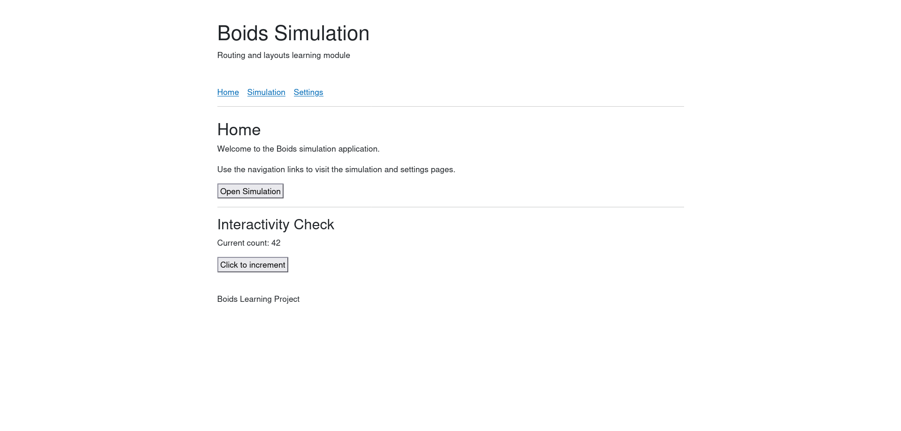

# Routing & Layouts

## Micro Goal

Understand how Blazor maps URLs to Razor components, navigates between pages, passes values through route parameters, and uses layouts to provide a consistent structure across an application.

## Concepts Covered

- Blazor routing and the router
- Routable Razor components and the `@page` directive
- Route templates and route parameters
- Optional route parameters and multiple route templates
- Route constraints
- Reading route values in components
- Navigation with `NavLink` and `NavigationManager`
- Client-side navigation
- Layout components and `MainLayout`
- The `@layout` directive
- `LayoutComponentBase` and `@Body`
- Shared navigation and page structure
- Nested layouts
- Not-found content
- Query strings and query parameters
- Route organization and URL design

## Completion Criteria

- [ ] Create multiple routable Razor components using `@page`.
- [ ] Explain how a URL maps to a component.
- [ ] Define route parameters and use their values in a component.
- [ ] Apply route constraints to restrict accepted parameter values.
- [ ] Navigate between pages using `NavLink` and `NavigationManager`.
- [ ] Create a layout component that provides shared page structure.
- [ ] Use `@Body` to render the active page inside a layout.
- [ ] Apply a layout to multiple pages.
- [ ] Configure and display not-found content.
- [ ] Read query-string values when a page needs them.
- [ ] Explain the difference between route parameters and query parameters.
- [ ] Organize page routes and navigation for a small Blazor application.

## Lecture

### 1. What routing does

Routing determines which component should render for a given URL. In a Blazor application, a URL identifies a page component rather than requiring a separate HTML file for every page.

For example, a Boids application might have these pages:

- `/` — the home page.
- `/simulation` — the simulation page.
- `/settings` — the settings page.
- `/simulation/42` — a simulation identified by the value `42`.

Each URL can map to a different Razor component. This allows an application to have multiple pages while reusing shared components and application logic.

Routing does not itself implement the behavior of a page. It determines which component is selected for a URL; the component is responsible for displaying content and handling its own interactions.

### 2. Routable components and `@page`

A Razor component becomes routable when it declares a route template with the `@page` directive.

For example, a component in `Pages/Home.razor` can define the home route:

```razor
@page "/"

<h1>Home</h1>

<p>Welcome to the Boids application.</p>
```

A component in `Pages/Simulation.razor` can define a simulation route:

```razor
@page "/simulation"

<h1>Simulation</h1>

<p>The simulation interface will be displayed here.</p>
```

The route template determines which URL selects the component. The file name does not have to match the route, although meaningful names make projects easier to understand.

A routable component normally belongs in the application's page directory, but routing is based on the component's route metadata and the application's routing configuration, not simply its physical location.

### 3. Route parameters

A route parameter allows a URL to supply a value to a page. This is useful when a page represents a particular resource.

For example:

```razor
@page "/simulation/{SimulationId:int}"

<h1>Simulation @SimulationId</h1>

<p>Viewing simulation ID: @SimulationId</p>

@code {
    [Parameter]
    public int SimulationId { get; set; }
}
```

The route template includes `{SimulationId:int}`. The `int` constraint indicates that the route parameter must be an integer for this route to match.

A URL such as `/simulation/42` supplies `42` to the component's `SimulationId` parameter.

The `[Parameter]` attribute marks a property as a value that can be supplied by the component's parent or, for a routable component, by routing.

A route parameter is not the same as a field read directly from the URL. Blazor binds the matched route value to the component parameter, making it available to the component's rendering and logic.

### 4. Route constraints

A route constraint restricts which values match a route. Common constraints include:

- `int` — integer values.
- `long` — long integer values.
- `guid` — GUID values.
- `bool` — Boolean values.
- `datetime` — date and time values.
- `decimal` — decimal values.
- `alpha` — alphabetic characters.

For example:

```razor
@page "/boids/{BoidId:int}"

<h1>Boid @BoidId</h1>

@code {
    [Parameter]
    public int BoidId { get; set; }
}
```

The route matches integer identifiers such as `/boids/12`, but not `/boids/abc`.

A constraint determines whether a route matches; it is not a complete validation strategy. If a request contains a value that does not match any route, the router may show its not-found content. If a value matches the route but violates a business rule, the application must handle that rule separately.

For example, the route constraint `int` does not guarantee that the identifier is positive or that the corresponding boid exists.

### 5. Multiple route templates

A component can declare multiple route templates. This is useful when the same page should be reachable through more than one URL.

```razor
@page "/simulation"
@page "/simulation/current"

<h1>Current Simulation</h1>
```

Both `/simulation` and `/simulation/current` select the same component.

Use multiple route templates when they represent genuinely equivalent entry points. Avoid creating many aliases without a reason, because unnecessary route variants make navigation harder to understand.

### 6. Navigation with `NavLink`

`NavLink` is a Blazor component used to navigate to another route. It behaves like a link while also supporting an active state when its target matches the current URL.

```razor
<nav>
    <NavLink href="/" Match="NavLinkMatch.All">
        Home
    </NavLink>

    <NavLink href="/simulation">
        Simulation
    </NavLink>

    <NavLink href="/settings">
        Settings
    </NavLink>
</nav>
```

The `href` property specifies the target URL. `NavLinkMatch.All` requires an exact route match for the home link. The default matching behavior is typically based on the URL prefix, which is useful for navigation sections but may require explicit matching behavior for links that could overlap.

For example, a link to `/simulation` may remain active on `/simulation/42` depending on the matching behavior. Choose the appropriate matching mode for the navigation hierarchy.

`NavLink` integrates with Blazor's navigation system, allowing the application to update the active link state as the URL changes.

### 7. Programmatic navigation with `NavigationManager`

Sometimes navigation should happen in response to an event or a completed operation rather than a link click. Blazor provides `NavigationManager` for programmatic navigation.

```razor
@page "/"

@inject NavigationManager Navigation

<h1>Home</h1>

<button @onclick="OpenSimulation">
    Open Simulation
</button>

@code {
    private void OpenSimulation()
    {
        Navigation.NavigateTo("/simulation");
    }
}
```

The component injects `NavigationManager` and calls `NavigateTo` when the button is clicked.

Programmatic navigation is useful after operations such as saving a form, choosing a simulation, or completing a workflow. Use ordinary links for normal navigation where possible, because links are more discoverable and work naturally with browser behavior.

Navigation can also be configured to force a full page load or replace the current history entry, but those options should be used only when the application requires that behavior.

### 8. Layout components

A layout provides a shared structure for multiple pages. Most applications have common elements such as a header, navigation menu, footer, or content container.

Without layouts, each page might duplicate the same structure. This creates unnecessary repetition and makes shared changes harder to maintain.

A layout is a Razor component that inherits from `LayoutComponentBase`. Its `@Body` expression indicates where the selected page's content should appear.

For example, `Shared/MainLayout.razor` might contain:

```razor
@inherits LayoutComponentBase

<div class="app-shell">
    <header>
        <h1>Boids Simulation</h1>
    </header>

    <nav>
        <NavLink href="/" Match="NavLinkMatch.All">
            Home
        </NavLink>

        <NavLink href="/simulation">
            Simulation
        </NavLink>

        <NavLink href="/settings">
            Settings
        </NavLink>
    </nav>

    <main>
        @Body
    </main>

    <footer>
        <p>Boids Learning Project</p>
    </footer>
</div>
```

`@Body` is replaced by the content of the currently selected page. The header, navigation, and footer remain shared across pages using this layout.

The layout is not itself a route. It is a component that wraps page content.

### 9. Applying a layout

A page can select a layout with the `@layout` directive:

```razor
@page "/settings"
@layout MainLayout

<h1>Settings</h1>

<p>Configure simulation preferences here.</p>
```

The layout component must be available in the page's namespace, usually through the project's imports configuration.

Many Blazor templates configure a default layout through the router or a routing component. In those projects, pages may not need to declare `@layout` individually.

The exact routing setup depends on the Blazor template and render mode. When working in an existing application, inspect its routing configuration and use the conventions already established by the project.

### 10. Nested layouts

A nested layout allows one layout to build on another. For example, an administration section might have its own secondary navigation while still using the application's main layout.

A nested layout can inherit from another layout component and provide additional structure around its own `@Body`.

This is useful when a group of pages shares a common structure that differs from the rest of the application.

However, nested layouts add another layer of composition. Use them when they represent a meaningful section of the application, not simply to avoid writing a few lines of markup.

### 11. Not-found content

When a URL does not match any available route, the router needs to display a not-found state.

The exact configuration depends on the Blazor template and routing setup. In a traditional router configuration, the `NotFound` content can be defined inside the router:

```razor
<Router AppAssembly="typeof(Program).Assembly">
    <Found Context="routeData">
        <RouteView RouteData="routeData"
                   DefaultLayout="typeof(MainLayout)" />
    </Found>

    <NotFound>
        <LayoutView Layout="typeof(MainLayout)">
            <h1>Page not found</h1>
            <p>The requested page does not exist.</p>
        </LayoutView>
    </NotFound>
</Router>
```

This illustrates the traditional `Router` and `RouteView` pattern. Newer Blazor Web App templates may use a different routing component arrangement, so follow the routing structure already present in your project rather than replacing it with this snippet blindly.

Not-found content should provide a clear explanation and, where useful, a way to return to a known page.

A client-side route not matching a component is also distinct from a server returning an HTTP `404` response. In a Blazor application, routing and server fallback behavior determine how those cases are handled.

### 12. Query strings and query parameters

Route parameters identify a resource or section through the route path. Query parameters provide additional values in the URL after a question mark.

For example:

```text
/simulation/42?mode=paused&showTrails=true
```

Here, `42` is a route parameter. `mode` and `showTrails` are query parameters.

Query strings are useful for optional settings that should be shareable through a URL, such as a display mode, filter, or selected tab.

In a Razor component, the `[SupplyParameterFromQuery]` attribute can bind query-string values to component parameters:

```razor
@page "/simulation"

<h1>Simulation</h1>

<p>Mode: @(Mode ?? "default")</p>
<p>Show trails: @ShowTrails</p>

@code {
    [SupplyParameterFromQuery(Name = "mode")]
    public string? Mode { get; set; }

    [SupplyParameterFromQuery(Name = "showTrails")]
    public bool ShowTrails { get; set; }
}
```

For a URL such as `/simulation?mode=paused&showTrails=true`, the component receives the query values and displays them.

Query values are user-controlled input. Validate them before using them to drive important application behavior. Do not place secrets, passwords, or sensitive private data in a query string.

### 13. Designing routes for an application

Routes should communicate the structure of the application and remain predictable.

For the Boids simulation, routes might eventually include:

- `/` — application home page.
- `/simulation` — the active simulation interface.
- `/simulation/{id:int}` — a specific saved or shared simulation.
- `/settings` — application preferences.

These are examples, not a requirement to implement persistence or shared simulations in this module.

A route should describe the resource or page it represents. Route parameters should identify a resource, while query parameters should generally represent optional filters or display choices.

As the application evolves, consistent route conventions make links easier to share, navigation easier to understand, and tests easier to write.

### 14. Routing and layouts in the Boids application

The simulation interface will eventually be part of a larger application with multiple pages and shared navigation. Routing will allow users to move between those pages, while layouts provide a consistent shell.

The simulation itself may contain many interactive controls and visual elements. Those elements should usually be separate components rather than being placed directly into the layout.

A useful separation is:

- **Routes** determine which page is displayed.
- **Layouts** provide shared application structure.
- **Pages** compose components for a particular route.
- **Components** implement reusable interface elements and interactions.

This separation makes the application easier to change as features are added. It also keeps the layout independent from the simulation's internal rendering logic.

## Challenge

Build a small Blazor application with multiple pages, route parameters, shared navigation, and a common layout.

Your solution must satisfy all of the following requirements:

1. **Create three pages:** Implement a home page at `/`, a simulation page at `/simulation`, and a settings page at `/settings`.
2. **Create a shared layout:** Provide a layout containing a header, navigation links, a main content area, and a footer.
3. **Use navigation links:** Navigate between all three pages using `NavLink`, and configure active matching appropriately.
4. **Add a route parameter:** Create a page at `/simulation/{SimulationId:int}` that displays the supplied simulation ID.
5. **Use programmatic navigation:** Add a button on the home page that navigates to `/simulation`.
6. **Use query parameters:** Allow the simulation page to read an optional `mode` query parameter and display its value or a sensible default.
7. **Handle unknown routes:** Configure not-found content that uses the shared layout where appropriate.
8. **Keep components focused:** Put shared structure in the layout, page-specific content in the pages, and avoid duplicating navigation markup.
9. **Test navigation manually:** Run the application and visit each route directly in the browser, including a valid simulation ID, an invalid route, and a simulation URL with a query string.
10. **Explain the routing behavior:** Be able to describe how the URL selects a component, how route parameters differ from query parameters, and how `@Body` places page content inside a layout.



