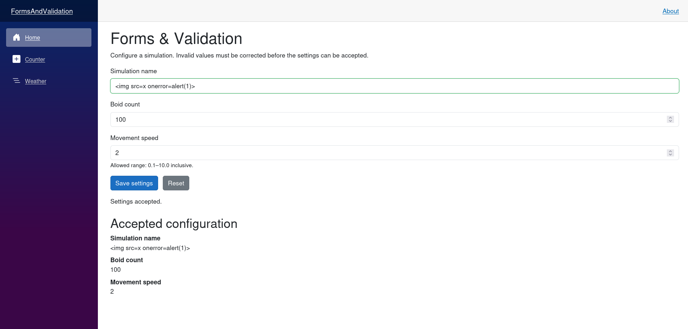

# Forms & Validation

## Micro Goal

Build interactive Blazor forms that bind user input to C# models, validate data before submission, display useful validation messages, and handle untrusted input safely to reduce the risk of malicious content injection and other invalid requests.

## Concepts Covered

- Blazor `EditForm`
- Form models and data binding
- `InputText`, `InputNumber`, `InputCheckbox`, and other input components
- `EditContext`
- Data annotations and validation attributes
- `DataAnnotationsValidator`
- `ValidationSummary` and `ValidationMessage`
- Required fields, length limits, ranges, and format validation
- Custom validation rules
- Form submission with `OnValidSubmit` and `OnInvalidSubmit`
- Resetting forms and clearing validation state
- Client-side versus server-side validation
- Untrusted input and input handling
- Cross-site scripting (XSS) and malicious content injection
- HTML encoding and safe rendering
- Why input validation is not a substitute for output encoding
- Server-side validation and API trust boundaries
- Request size limits and defensive input handling
- Safe error messages and avoiding sensitive information disclosure

## Completion Criteria

- [ ] Build a form using `EditForm` and a strongly typed model.
- [ ] Bind input components to model properties.
- [ ] Apply data annotation attributes to validate submitted values.
- [ ] Display field-level and form-level validation messages.
- [ ] Handle valid and invalid form submissions separately.
- [ ] Implement a custom validation rule when data annotations are insufficient.
- [ ] Explain why browser-side validation can be bypassed.
- [ ] Validate untrusted input on the server or API boundary.
- [ ] Explain how malicious content can cause XSS when rendered as executable markup.
- [ ] Use Blazor's normal text rendering rather than interpreting untrusted input as raw HTML.
- [ ] Explain the difference between validation, sanitization, and output encoding.
- [ ] Avoid treating user-provided strings as trusted HTML or JavaScript.
- [ ] Test valid, invalid, boundary, and malicious-looking input.
- [ ] Keep form handling simple, predictable, and separate from unrelated application logic.

## Lecture

### 1. Why forms and validation matter

Forms allow users to provide data to an application. In the Boids simulation, users might configure a simulation name, the number of boids, movement speed, or other simulation parameters.

A form needs to do more than collect values. It must help users understand what data is acceptable, prevent accidental invalid submissions, and ensure that invalid or malicious data does not enter trusted application logic.

Consider a simulation configuration:

```csharp
public class SimulationSettings
{
    public string Name { get; set; } = string.Empty;

    public int BoidCount { get; set; }

    public double MovementSpeed { get; set; }
}
```

This model defines the data the form will collect. It does not yet define which values are valid. For example, a negative boid count or an empty name may be inappropriate.

Blazor forms provide a way to bind input controls to model properties, run validation, and display feedback. The same rules must also be enforced at the server boundary if the data will be sent to an API or persisted on a server.

### 2. `EditForm` and model binding

Blazor's `EditForm` is the primary component for building forms around a model or an `EditContext`.

```razor
<EditForm Model="@settings" OnValidSubmit="@SaveSettings">
    <label for="simulation-name">Simulation name</label>
    <InputText id="simulation-name" @bind-Value="settings.Name" />

    <label for="boid-count">Boid count</label>
    <InputNumber id="boid-count" @bind-Value="settings.BoidCount" />

    <label for="movement-speed">Movement speed</label>
    <InputNumber id="movement-speed" @bind-Value="settings.MovementSpeed" />

    <button type="submit">Save settings</button>
</EditForm>

@code {
    private SimulationSettings settings = new();

    private void SaveSettings()
    {
        // Process valid settings.
    }
}
```

`Model` identifies the object whose properties are edited. `@bind-Value` connects an input component to a property, allowing the UI and model to exchange values.

`OnValidSubmit` runs when the form's validation process considers the model valid. This example does not yet include validation rules, so the next step is to add them.

The built-in input components understand Blazor's form and validation infrastructure. A normal HTML input can still be used, but the `Input...` components provide convenient integration with `EditForm` and `EditContext`.

### 3. Data annotations

Data annotations allow common validation rules to be declared directly on model properties. The attributes are available through `System.ComponentModel.DataAnnotations`.

```csharp
using System.ComponentModel.DataAnnotations;

public class SimulationSettings
{
    [Required]
    [StringLength(40, MinimumLength = 3)]
    public string Name { get; set; } = string.Empty;

    [Range(1, 500)]
    public int BoidCount { get; set; }

    [Range(0.1, 10.0)]
    public double MovementSpeed { get; set; }
}
```

These rules express the following constraints:

- `Name` must be provided and must contain between 3 and 40 characters.
- `BoidCount` must be between 1 and 500, inclusive.
- `MovementSpeed` must be between 0.1 and 10.0, inclusive.

These limits are example application rules, not universal requirements for every Boids simulation.

`[Required]` checks that a value is present. For strings, whitespace-only values may require additional validation depending on the behavior you want. If whitespace-only names should be rejected, enforce that explicitly rather than assuming every validation attribute trims the input.

`[Range]` checks numeric boundaries. Other useful attributes include `[EmailAddress]`, `[RegularExpression]`, and `[MaxLength]`, depending on the data being collected.

Validation attributes declare rules; the application must invoke a validation mechanism that evaluates them.

### 4. Displaying validation feedback

To enable data annotation validation in an `EditForm`, add `DataAnnotationsValidator`. You can display all validation errors or show errors next to individual fields.

```razor
<EditForm Model="@settings" OnValidSubmit="@SaveSettings">
    <DataAnnotationsValidator />
    <ValidationSummary />

    <label for="simulation-name">Simulation name</label>
    <InputText id="simulation-name" @bind-Value="settings.Name" />
    <ValidationMessage For="@(() => settings.Name)" />

    <label for="boid-count">Boid count</label>
    <InputNumber id="boid-count" @bind-Value="settings.BoidCount" />
    <ValidationMessage For="@(() => settings.BoidCount)" />

    <label for="movement-speed">Movement speed</label>
    <InputNumber id="movement-speed" @bind-Value="settings.MovementSpeed" />
    <ValidationMessage For="@(() => settings.MovementSpeed)" />

    <button type="submit">Save settings</button>
</EditForm>
```

`DataAnnotationsValidator` integrates data annotation rules with the form's validation process.

`ValidationSummary` displays a summary of validation errors. `ValidationMessage` displays messages associated with a particular field.

These messages improve usability, but they are not a security boundary. A malicious client can submit a request without using the form at all.

### 5. Valid and invalid submission handlers

Blazor supports several form submission callbacks:

- `OnValidSubmit` runs when validation succeeds.
- `OnInvalidSubmit` runs when validation fails.
- `OnSubmit` gives you control over submission and validation flow.

Use `OnValidSubmit` when the form should process data only after validation passes.

```razor
<EditForm Model="@settings" OnValidSubmit="@SaveSettings">
    <DataAnnotationsValidator />
    <ValidationSummary />

    <!-- Form fields go here. -->

    <button type="submit">Save settings</button>
</EditForm>

@code {
    private SimulationSettings settings = new();

    private string? statusMessage;

    private void SaveSettings()
    {
        statusMessage = "Settings are valid.";
    }
}
```

This handler should not be treated as proof that the data is trustworthy. It only indicates that the current form validation succeeded. If the settings are sent to a backend, the backend must validate them again.

When using `OnSubmit`, you are responsible for invoking the validation process if you want validation to determine whether the data may be processed. Do not accidentally bypass validation by handling submission without checking the form's validity.

### 6. The `EditContext`

`EditContext` represents the editing state of a form. It tracks information such as field modifications and validation messages.

Blazor can create an `EditContext` from a model automatically when you use `EditForm Model="..."`. You can also create and supply one directly:

```razor
<EditForm EditContext="@editContext" OnValidSubmit="@SaveSettings">
    <DataAnnotationsValidator />
    <ValidationSummary />

    <InputText @bind-Value="settings.Name" />

    <button type="submit">Save</button>
</EditForm>

@code {
    private SimulationSettings settings = new();
    private EditContext editContext = default!;

    protected override void OnInitialized()
    {
        editContext = new EditContext(settings);
    }

    private void SaveSettings()
    {
        // Process the valid form.
    }
}
```

Use either `Model` or `EditContext` for a particular `EditForm`; do not supply both.

An explicit `EditContext` is useful when you need to inspect or control validation behavior, respond to field changes, or integrate custom validation logic. For simple forms, model-based binding is usually sufficient.

### 7. Custom validation

Data annotations cover many common rules, but some constraints depend on relationships between fields or application-specific logic.

For example, suppose a simulation has both a minimum and maximum boid count. The minimum cannot exceed the maximum.

```csharp
public class BoidRangeSettings
{
    [Range(1, 500)]
    public int MinimumBoids { get; set; } = 10;

    [Range(1, 500)]
    public int MaximumBoids { get; set; } = 100;
}
```

The individual properties can be valid while the combination is invalid. A custom validator or an `EditContext` validation handler can enforce the relationship.

For more involved form validation, Blazor supports custom validation through `ValidationMessageStore` associated with an `EditContext`. This lets the application add and clear validation messages programmatically.

Custom validation should have a clear responsibility. Keep basic property constraints in data annotations when possible, and introduce custom logic for rules that genuinely depend on multiple fields or application state.

Regardless of the mechanism used in the UI, the server must enforce important business rules before accepting or storing the data.

### 8. Client-side validation is not a security boundary

A browser form is controlled by the user. A user can alter page state, disable JavaScript, modify requests, or send HTTP requests directly with a tool such as `curl`.

Therefore, client-side validation is primarily a usability feature. It helps legitimate users correct mistakes before submitting a request.

Consider a form that restricts `BoidCount` to 1–500. A malicious client could bypass the form and send a request containing `BoidCount: 1000000000`.

If the server trusts the UI's validation, it may accept data that causes excessive resource consumption or breaks application assumptions.

The backend must independently validate:

- Required values and allowed formats.
- Numeric ranges and collection sizes.
- Business rules and relationships between fields.
- Authorization requirements.
- Any constraints needed to prevent excessive processing or storage.

The server should reject invalid input before performing expensive work or modifying persistent state.

### 9. Malicious content injection and cross-site scripting

One security risk when accepting user-provided text is cross-site scripting (XSS). XSS occurs when untrusted content is interpreted by a browser as executable content, allowing an attacker to run scripts in a user's browser under the application's origin.

For example, a user might submit a simulation name containing markup such as:

```html
<script>alert('unexpected script execution')</script>
```

A name field normally should treat this as text, not as code. The dangerous situation occurs when the application later inserts the untrusted string into a context that interprets it as executable markup or script.

Blazor's normal Razor rendering encodes string values when rendering them as text:

```razor
<p>Simulation name: @settings.Name</p>
```

This is the correct default for displaying user-provided text. The content is rendered as text rather than treated as raw HTML.

Avoid using `MarkupString` to render untrusted input as HTML:

```razor
@* Do not do this with untrusted content. *@
@((MarkupString)settings.Name)
```

`MarkupString` tells Blazor to treat the value as markup. If the value contains attacker-controlled HTML, this can introduce an XSS vulnerability.

The practical rule is straightforward: **render user-provided strings as ordinary text unless there is a well-defined and secure reason to render HTML.**

### 10. Validation, sanitization, and output encoding are different

These concepts address different problems:

**Validation** determines whether input conforms to the application's rules. A simulation name might be required, limited to 40 characters, and prohibited from containing certain control characters.

**Sanitization** transforms input to remove or neutralize content according to a specific policy. If the application intentionally accepts user-authored HTML, use a reputable HTML sanitizer with an explicit allowlist policy rather than trying to strip dangerous strings manually.

**Output encoding** ensures that data is interpreted as data, rather than executable syntax, in the context where it is displayed. Razor's normal text rendering provides HTML encoding for ordinary string output.

These techniques are not interchangeable. Removing the substring `<script>` is not a reliable defense against XSS, because executable markup can take many forms and risks depend on the rendering context.

For ordinary text fields such as simulation names, comments, or labels, the simplest secure approach is to validate the input according to the application's rules and render it as text.

If an application intentionally supports rich HTML content, it needs a separate, carefully designed sanitization policy. Avoid introducing rich HTML rendering for a feature that only needs plain text.

### 11. Other injection risks and safe request handling

XSS is not the only possible risk. User-controlled data can also cause problems when used in database queries, operating system commands, file paths, or other interpreters.

The defense depends on the destination:

- Use parameterized database operations or an ORM rather than constructing SQL queries by concatenating input.
- Avoid building shell commands from user input. Prefer safe APIs and tightly controlled arguments where external processes are necessary.
- Validate file names and paths, and constrain access to intended directories.
- Apply authorization checks before allowing a user to modify or access protected resources.
- Limit request sizes and the amount of work a request can trigger.

Validation is important, but it does not replace using APIs that safely handle data for their intended context.

### 12. Server-side validation in an ASP.NET Core API

If a Blazor form sends data to an ASP.NET Core API, the API is a separate trust boundary. The API must not assume the request came from a valid Blazor form.

For example, a request model can declare constraints:

```csharp
using System.ComponentModel.DataAnnotations;

public class CreateSimulationRequest
{
    [Required]
    [StringLength(40, MinimumLength = 3)]
    public string Name { get; set; } = string.Empty;

    [Range(1, 500)]
    public int BoidCount { get; set; }

    [Range(0.1, 10.0)]
    public double MovementSpeed { get; set; }
}
```

The API must then invoke the appropriate validation mechanism and reject invalid requests before creating or updating resources. The exact behavior depends on whether the endpoint uses Minimal APIs, MVC controllers, or custom validation logic.

Do not assume that adding attributes to a request class automatically enforces every validation rule for every endpoint style. Verify that the endpoint's framework and implementation actually perform validation and return appropriate client-error responses.

For the Boids project, the frontend can use the same basic constraints to provide immediate feedback, but the server remains authoritative.

### 13. Safe error messages

Validation errors should help users fix their input without revealing sensitive implementation details.

Useful messages include:

- "Boid count must be between 1 and 500."
- "Simulation name is required."
- "Movement speed must be positive."

Avoid exposing stack traces, database details, file system paths, secrets, or internal exception messages to users.

Log technical details on the server using an appropriate logging strategy, and return a safe error response to the client. Be careful not to log passwords, authentication tokens, or other sensitive input.

### 14. Resetting and managing form state

After a successful submission, an application may need to reset the form or prepare a new model. Replacing the model is often a simple approach.

```csharp
private void ResetSettings()
{
    settings = new SimulationSettings();
}
```

If the form uses a manually created `EditContext`, that context is associated with the model instance used to create it. When replacing the model, recreate the `EditContext` and ensure the form uses the new instance.

Form state should be managed deliberately. Avoid clearing validation messages or resetting values before you have processed the submitted data, and provide clear feedback after a successful or unsuccessful operation.

## Challenge

Build a Blazor form for creating or configuring a Boids simulation. The form must validate user input, display clear error messages, and handle untrusted text safely.

Your solution must satisfy all of the following requirements:

1. **Create a form model:** Define a `SimulationSettings` model with a simulation name, boid count, and movement speed.
2. **Add validation attributes:** Require a simulation name between 3 and 40 characters, restrict boid count to 1–500, and restrict movement speed to a documented positive range.
3. **Build the form:** Use `EditForm`, `InputText`, and `InputNumber` with two-way binding.
4. **Display validation:** Add `DataAnnotationsValidator`, `ValidationSummary`, and field-level `ValidationMessage` components.
5. **Handle submission:** Process valid submissions and provide visible feedback. Invalid submissions must not be processed as valid configurations.
6. **Test boundary conditions:** Verify behavior for empty names, overly long names, zero boids, counts above the maximum, negative speed, and values at the permitted boundaries.
7. **Handle untrusted text safely:** Enter a simulation name containing HTML-like content, such as `<script>alert('test')</script>`, and confirm that it is displayed as text rather than executed as markup.
8. **Avoid unsafe rendering:** Do not cast untrusted strings to `MarkupString` or otherwise interpret user-provided input as raw HTML.
9. **Explain the security boundary:** In comments or accompanying notes, explain why browser-side validation can be bypassed and why an API must validate requests independently.
10. **Separate responsibilities:** Keep the form model, validation rules, and submission logic understandable. Do not put unrelated simulation logic inside the form.
11. **Verify the result:** Run the application, submit both valid and invalid inputs, and inspect the rendered output.

The goal is to build a form that is usable for legitimate users, predictable when given invalid data, and safe when displaying untrusted text. Treat frontend validation as a user experience feature and enforce the application's real data rules at the server boundary.


