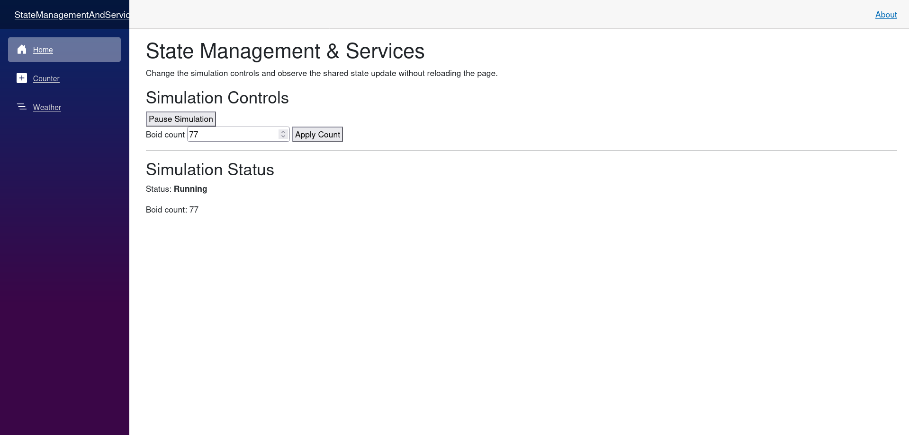

# State Management & Services

## Micro Goal

Understand how Blazor components manage local state, share application state across components, and use dependency injection to access services. Build a small, predictable state-management design that can support the Boids simulation as the application grows.

## Concepts Covered

- Component-local state
- Component lifecycle and state updates
- Parent-to-child parameters
- Child-to-parent event callbacks
- Shared state across components
- Dependency injection in Blazor
- Service registration and service lifetimes
- Singleton, scoped, and transient services
- State container services
- Event-based state notifications
- `StateHasChanged`
- `IDisposable` and event unsubscription
- Separation of UI components and application logic
- Immutable updates versus in-place mutation
- Choosing where application state belongs

## Completion Criteria

- [ ] Explain the difference between component-local state and shared application state.
- [ ] Use component parameters to pass data from a parent to a child.
- [ ] Use `EventCallback<T>` to notify a parent of a child interaction.
- [ ] Register a service through dependency injection and inject it into a component.
- [ ] Explain the practical differences between singleton, scoped, and transient service lifetimes.
- [ ] Create a state container that holds shared application data.
- [ ] Notify components when shared state changes.
- [ ] Subscribe to and unsubscribe from state-change events correctly.
- [ ] Explain when Blazor automatically rerenders a component and when an explicit state notification is needed.
- [ ] Keep UI rendering separate from state-management logic.
- [ ] Choose appropriate locations for component state, shared state, and service logic.
- [ ] Complete the challenge using multiple components that share and update the same state.

## Lecture

### 1. What application state is

State is the information an application needs to remember while it operates. In a Blazor application, state can include the values of form fields, the currently selected item, user preferences, loading indicators, and the current configuration of a simulation.

For a Boids simulation, state might include:

- The number of boids.
- The simulation's running or paused status.
- Movement and steering parameters.
- The current selected display mode.
- The simulation's current data.

Not all state belongs in the same place. A form's temporary input may belong to one component, while the simulation configuration may need to be shared by several components.

A useful starting principle is to keep state as close as practical to the components that need it. Move state into a shared service when multiple components must access or modify the same data.

### 2. Component-local state

A component can maintain its own state using ordinary C# fields and properties.

For example, a counter component can hold a count and update it when a user clicks a button:

```razor
<h3>Counter</h3>

<p>Count: @count</p>

<button @onclick="Increment">Increment</button>

@code {
    private int count;

    private void Increment()
    {
        count++;
    }
}
```

The `count` field belongs to that component instance. It is not automatically shared with other components.

When a Blazor event handler such as `Increment` runs, Blazor normally schedules a render after the handler completes. The component then displays the updated count.

Component-local state is appropriate for information that does not need to be shared, such as whether a particular panel is expanded or which tab is selected within that panel.

It is usually unnecessary to create a service for every small piece of component state.

### 3. Passing state through parameters

A parent component can pass data to a child through component parameters.

For example, the parent can provide a simulation title:

```razor
<SimulationSummary Title="Boids Simulation" />

@code {
}
```

The child component declares a parameter:

```razor
<h3>@Title</h3>

@code {
    [Parameter]
    public string Title { get; set; } = string.Empty;
}
```

The parent owns the value and supplies it to the child. This establishes a clear direction for data flow: the parent passes data down to the child.

Parameters are appropriate for configuration and values that a child needs in order to render or perform its role.

A child should not directly change a parameter that it does not own. Instead, it should notify the parent when a user interaction requires a change.

### 4. Notifying a parent with `EventCallback<T>`

A child can communicate a user action to its parent through an event callback.

For example, a child component might provide a button that asks the parent to change a simulation's running state.

The child component:

```razor
<button @onclick="NotifyParent">Toggle Simulation</button>

@code {
    [Parameter]
    public EventCallback<bool> RunningChanged { get; set; }

    [Parameter]
    public bool IsRunning { get; set; }

    private Task NotifyParent()
    {
        return RunningChanged.InvokeAsync(!IsRunning);
    }
}
```

The parent component:

```razor
<SimulationToggle
    IsRunning="@isRunning"
    RunningChanged="@HandleRunningChanged" />

<p>Running: @isRunning</p>

@code {
    private bool isRunning;

    private void HandleRunningChanged(bool newValue)
    {
        isRunning = newValue;
    }
}
```

The child does not own the authoritative running state. It reports the requested change, and the parent updates its own value.

This pattern keeps the ownership of state explicit and makes components easier to reuse.

For ordinary editable parameters, Blazor also supports the `@bind-` convention, which combines a value parameter and a corresponding change callback. Explicit `EventCallback<T>` is useful when you want to understand or control the data flow directly.

### 5. When local state is not enough

Parent-child parameters work well when components have a clear hierarchy. However, an application may have several components that need the same information.

Imagine a simulation page containing:

- A canvas displaying boids.
- A toolbar with start and pause controls.
- A settings panel that changes simulation parameters.
- A status panel showing the number of boids.

If each component maintains its own copy of the simulation configuration, those copies can become inconsistent. The toolbar might show that the simulation is running while the canvas behaves as if it were paused.

A shared state container provides one place for the state that these components need to coordinate.

The components still have separate rendering responsibilities, but they access the same underlying state through a shared service.

### 6. Dependency injection in Blazor

Dependency injection (DI) allows a component to receive a service instead of creating the service itself.

For example, a component can inject a service using the `@inject` directive:

```razor
@inject SimulationState State

<p>Running: @State.IsRunning</p>
```

The `SimulationState` service must be registered with the application's service container. In a Blazor Web App, registrations are typically configured in `Program.cs`:

```csharp
builder.Services.AddScoped<SimulationState>();
```

The service container creates and supplies instances according to the registered lifetime.

Dependency injection helps separate components from the implementation details of the services they use. Components depend on the service contract and behavior, rather than constructing the service directly.

For this module, the service can be a simple C# class. It does not need to access a database or a remote API.

### 7. Service lifetimes

.NET dependency injection supports several service lifetimes. The lifetime determines how instances are created and reused.

**Transient**

A transient service is created each time it is requested from the service provider. It is suitable for lightweight services that do not need to preserve shared mutable state between consumers.

```csharp
builder.Services.AddTransient<FormattingService>();
```

**Scoped**

A scoped service is reused within a dependency-injection scope. What that scope means depends on the application model.

In a server-side Blazor circuit, a scoped service normally lives for that circuit. In a typical WebAssembly application, scoped services generally behave like application-lifetime services because the client-side application uses a long-lived service provider.

```csharp
builder.Services.AddScoped<SimulationState>();
```

This difference matters. A scoped service in server-side Blazor should not be assumed to be shared across every connected user. Each circuit normally has its own scoped instance.

**Singleton**

A singleton service is shared by consumers using the same service provider for the lifetime of that provider.

```csharp
builder.Services.AddSingleton<FormattingService>();
```

In a server-hosted application, a singleton may be shared across many users. Mutable user-specific state stored in a singleton can therefore leak between users if it is not designed carefully.

Do not use a singleton for per-user state merely because multiple components need access to it.

For this learning module, a scoped state service is a sensible default for state that belongs to one Blazor application instance or server-side circuit. The exact choice should follow the intended scope of the data and the application's hosting model.

### 8. Creating a state container

A state container is a service that holds shared state and exposes operations for changing it.

For example:

```csharp
public sealed class SimulationState
{
    public bool IsRunning { get; private set; }

    public int BoidCount { get; private set; } = 100;

    public void SetRunning(bool isRunning)
    {
        IsRunning = isRunning;
    }

    public void SetBoidCount(int boidCount)
    {
        if (boidCount < 0)
        {
            throw new ArgumentOutOfRangeException(
                nameof(boidCount),
                "Boid count cannot be negative.");
        }

        BoidCount = boidCount;
    }
}
```

This service stores two pieces of shared state. Its methods control how those values change, so components do not need to modify the properties directly.

Register it in `Program.cs`:

```csharp
builder.Services.AddScoped<SimulationState>();
```

Then inject it into a component:

```razor
@inject SimulationState State

<p>Boids: @State.BoidCount</p>
<p>Running: @State.IsRunning</p>
```

At this point, the service holds shared data, but components still need a way to know when that data changes. Reading a property from a service does not automatically cause a component to rerender when some other component updates the service.

### 9. Notifying components when shared state changes

A shared state container can publish an event when its state changes. Components can subscribe to the event and request a rerender when notified.

For example, extend the service:

```csharp
public sealed class SimulationState
{
    public event Action? OnChange;

    public bool IsRunning { get; private set; }

    public int BoidCount { get; private set; } = 100;

    public void SetRunning(bool isRunning)
    {
        if (IsRunning == isRunning)
        {
            return;
        }

        IsRunning = isRunning;
        NotifyStateChanged();
    }

    public void SetBoidCount(int boidCount)
    {
        if (boidCount < 0)
        {
            throw new ArgumentOutOfRangeException(
                nameof(boidCount));
        }

        if (BoidCount == boidCount)
        {
            return;
        }

        BoidCount = boidCount;
        NotifyStateChanged();
    }

    private void NotifyStateChanged()
    {
        OnChange?.Invoke();
    }
}
```

The service exposes an event named `OnChange`. After a meaningful state update, it raises the event. The equality checks avoid notifying components when the requested value has not changed.

A component can subscribe and request a render:

```razor
@implements IDisposable
@inject SimulationState State

<p>Boids: @State.BoidCount</p>
<p>Running: @State.IsRunning</p>

@code {
    protected override void OnInitialized()
    {
        State.OnChange += HandleStateChanged;
    }

    private void HandleStateChanged()
    {
        _ = InvokeAsync(StateHasChanged);
    }

    public void Dispose()
    {
        State.OnChange -= HandleStateChanged;
    }
}
```

`StateHasChanged` tells Blazor that the component should render again. `InvokeAsync` dispatches the update through the component's synchronization context, which is important when a notification can originate outside the normal component event flow.

The component implements `IDisposable` so that it can unsubscribe from the event when it is disposed. Without unsubscription, the service may retain a reference to a component that is no longer in use, causing unnecessary notifications and potential memory leaks.

In a larger application, you may want to use a more structured state-management approach. For this learning module, a simple event-based state container is sufficient to understand the mechanism.

### 10. Why component rerendering matters

Blazor renders components when it determines that their UI may have changed. Event handlers and parameter updates commonly trigger rendering automatically.

However, a service property changing does not automatically notify every component that reads it. The component needs a trigger, such as:

- A normal component event that updates local state.
- A new parameter value from its parent.
- A notification from a subscribed state container.
- Another supported rendering lifecycle event.

When a component subscribes to a service event, the handler can call `StateHasChanged` to request a render. When the notification may arrive outside the component's normal event handling, `InvokeAsync(StateHasChanged)` is the safer pattern.

Avoid calling `StateHasChanged` repeatedly without a meaningful state change. Unnecessary rendering makes the application harder to reason about and can reduce performance.

### 11. Avoiding redundant state

A common mistake is storing the same information in several places without a clear reason.

For example, if a shared service owns `IsRunning`, a component usually should not maintain another `isRunning` field that attempts to mirror the service value indefinitely. The two values can drift apart.

Instead, choose one authoritative source of truth for each piece of state.

Derived values generally do not need separate storage. If a component can calculate a status label from `IsRunning`, calculate it from the current state rather than maintaining another field that must be synchronized.

For example:

```csharp
string status = State.IsRunning ? "Running" : "Paused";
```

This keeps the state model simpler and reduces the number of updates required when the underlying value changes.

### 12. Choosing where state belongs

Use the following guidelines when deciding where a value should live:

- **Component-local state:** A value used only by one component, such as whether a local panel is expanded.
- **Parent-owned state:** A value shared between a parent and its children, with the parent controlling changes.
- **Scoped state service:** Shared state needed by several components within one application instance or server-side circuit.
- **Persistent storage:** Data that must survive an application reload or restart. This requires a suitable persistence mechanism rather than just an in-memory field.
- **Server-managed shared state:** Data that must be authoritative across multiple users or connected clients. This requires coordination on the server or through another shared backend; a per-user state container alone is insufficient.

For the Boids simulation, the initial state container might hold configuration values and the current running status. The actual simulation engine can later be separated into its own service if it has independent responsibilities.

The future multi-user requirement will need a distinction between local UI state and shared simulation state. A user's open settings panel is local to that user, while a simulation configuration or interaction intended to affect everyone must be coordinated through shared application logic. We do not need to implement that coordination in this module.

### 13. Keeping services focused

A state service should manage state and expose meaningful operations. It should not also render HTML, directly manipulate component markup, or contain unrelated UI details.

Likewise, a component should focus on displaying data and responding to user interactions. It should not duplicate a large amount of business logic that belongs in a service or model.

For example, a `SimulationState` service can own the running flag and configuration values, while a settings component displays controls that call its methods.

This separation makes the code easier to understand and test. It also gives the application room to evolve without requiring every component to be rewritten whenever the underlying logic changes.

## Challenge

Build a small Blazor interface that uses a shared state container to manage a Boids simulation's configuration and running status.

Your application must satisfy all of the following requirements:

1. **Create a state service:** Implement a `SimulationState` class that stores the simulation's running status and boid count.
2. **Validate state changes:** Ensure the boid count cannot be negative. Avoid notifying components when a requested value is unchanged.
3. **Register the service:** Register `SimulationState` with dependency injection using a lifetime appropriate for state shared within one Blazor application instance or server-side circuit.
4. **Create multiple components:** Build a simulation status component and a separate controls component.
5. **Share state:** Both components must access the same `SimulationState` instance.
6. **Update state:** The controls component must provide a way to start or pause the simulation and change the boid count.
7. **Notify state changes:** Implement an event-based notification mechanism so that components update when shared state changes.
8. **Render current state:** The status component must display the current running status and boid count, updating when the controls change them.
9. **Manage subscriptions:** Components that subscribe to the service event must unsubscribe when disposed.
10. **Keep responsibilities clear:** Components should handle presentation and user interaction; the state service should own the shared state and its update rules.
11. **Verify behavior:** Confirm that changing the controls updates the status component without reloading the page, and that invalid boid counts are rejected.


