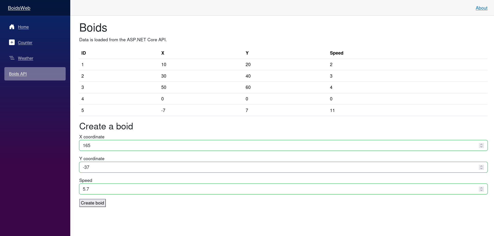

# HTTP & API Integration

## Micro Goal

Learn how a Blazor component communicates with an ASP.NET Core API using `HttpClient`, sends and receives JSON data, handles asynchronous HTTP requests, and presents loading, success, and error states in the user interface.

## Concepts Covered

- Client-server communication
- HTTP requests and responses
- `HttpClient` in Blazor
- Dependency injection for HTTP services
- Base addresses and relative URLs
- HTTP methods: `GET`, `POST`, `PUT`, and `DELETE`
- JSON serialization and deserialization
- DTOs and API response models
- Asynchronous requests with `async` and `await`
- `GetFromJsonAsync` and `PostAsJsonAsync`
- `HttpResponseMessage` and status codes
- Handling unsuccessful responses
- Loading, empty, success, and error UI states
- Cancellation tokens and component lifecycle
- Separating API communication from UI components
- Basic CORS concepts
- Testing API integration during development

## Completion Criteria

- [ ] Explain the roles of the Blazor frontend and ASP.NET Core API.
- [ ] Configure and inject an `HttpClient` appropriate for the Blazor hosting model.
- [ ] Send a `GET` request and deserialize a JSON response into typed C# objects.
- [ ] Send a JSON request body using `POST`.
- [ ] Understand when to use `PUT` and `DELETE`.
- [ ] Use `async` and `await` to perform HTTP operations without blocking normal UI interaction.
- [ ] Handle HTTP status codes and unsuccessful responses.
- [ ] Display loading, empty, success, and error states in a component.
- [ ] Separate API communication from presentation logic.
- [ ] Understand the purpose of CORS when frontend and API origins differ.
- [ ] Handle component disposal and cancellation where appropriate.
- [ ] Build a Blazor page that retrieves and displays data from an ASP.NET Core API.

## Lecture

### 1. Why API integration matters

A Blazor application can render an interface and execute C# code, but many applications also need to retrieve or modify data managed by a backend service.

For the Boids project, the frontend might eventually need to retrieve simulation configuration, submit user interactions, or communicate with a shared simulation service. The API provides an HTTP interface through which the frontend and backend exchange data.

The basic interaction looks like this:

1. A user opens a Blazor page.
2. The component sends an HTTP request to an API.
3. The API processes the request and returns an HTTP response.
4. The frontend deserializes the response into C# objects.
5. The component renders the resulting data.

The frontend and API are separate responsibilities. The Blazor component manages presentation and user interaction; the API handles the server-side operations exposed through its endpoints.

An HTTP API is not the same as a database. The frontend normally communicates with the API rather than connecting directly to the database. This allows the backend to enforce validation, authorization, and data-access rules.

### 2. Understanding the HTTP request-response cycle

An HTTP request contains a method, a URL, headers, and sometimes a body. The response contains a status code, headers, and potentially a body.

For example:

```http
GET /api/boids HTTP/1.1
Host: localhost:5000
Accept: application/json
```

A successful response might look like:

```http
HTTP/1.1 200 OK
Content-Type: application/json
```

```json
[
  {
    "id": 1,
    "x": 10.0,
    "y": 20.0,
    "speed": 2.0
  }
]
```

The examples illustrate the shape of an HTTP exchange; actual headers, URLs, and JSON formatting can differ.

The most common HTTP methods are:

- `GET`: retrieve data.
- `POST`: submit data, commonly to create a resource or initiate an operation.
- `PUT`: replace a resource or update it according to the API's contract.
- `DELETE`: request deletion of a resource.

The method alone does not determine every detail of the behavior. The API's documented contract specifies what each endpoint accepts and returns.

### 3. What `HttpClient` does

In .NET, `HttpClient` sends HTTP requests and receives responses. Blazor components commonly use it through dependency injection rather than creating a new client for every request.

A simple example is:

```csharp
HttpResponseMessage response =
    await httpClient.GetAsync("api/boids");
```

The `await` expression suspends the current asynchronous operation until the request completes. It does not synchronously block the UI thread while waiting for the network.

The returned `HttpResponseMessage` provides the status code, headers, and response content. The caller must still inspect the result and decide how to handle it.

How `HttpClient` is configured depends on the Blazor hosting model. In a WebAssembly application, requests originate from the user's browser and are subject to browser security rules. In a server-side Blazor application, requests made by server-side code originate from the server. These models have different security, networking, and configuration implications.

### 4. Configuring `HttpClient` with dependency injection

Blazor applications commonly register services in `Program.cs` and inject them into components.

For a Blazor WebAssembly application, a typical registration is:

```csharp
builder.Services.AddScoped(sp =>
    new HttpClient
    {
        BaseAddress = new Uri(
            builder.HostEnvironment.BaseAddress)
    });
```

This configures a base address using the application's host address. Relative request URLs are resolved against that base address.

For a server-side Blazor application, the registration strategy differs. A named or typed client registered with `IHttpClientFactory` is often appropriate:

```csharp
builder.Services.AddHttpClient("BoidsApi", client =>
{
    client.BaseAddress = new Uri(
        builder.Configuration["BoidsApi:BaseUrl"]
        ?? throw new InvalidOperationException(
            "BoidsApi:BaseUrl is not configured."));
});
```

A component or service can then obtain that named client through `IHttpClientFactory`.

The correct registration depends on the project template and hosting model. Do not copy a WebAssembly registration into a server-side application without checking how its services are configured.

The key concepts are:

- Register HTTP services in the application's dependency-injection container.
- Set a valid base address.
- Inject the service that performs HTTP requests.
- Avoid creating a new `HttpClient` for every operation.

### 5. Injecting `HttpClient` into a component

Razor components can inject registered services with the `@inject` directive.

For example:

```razor
@page "/boids"
@inject HttpClient Http

<h1>Boids</h1>
```

The injected `Http` variable is available to the component's C# code.

You can also use the `[Inject]` attribute in a component's code section or code-behind class. The directive is often the simplest option for a small component.

A component should not need to know how the HTTP client was constructed. That responsibility belongs to application configuration and dependency injection.

For larger applications, a dedicated API service can encapsulate HTTP requests, leaving the component focused on presentation.

### 6. Deserializing JSON with `GetFromJsonAsync`

JSON is a common format for transferring structured data over HTTP. .NET provides JSON extension methods that serialize and deserialize data.

Suppose the API returns objects with an identifier, position, and speed. Define a C# type representing that response:

```csharp
public sealed class BoidDto
{
    public int Id { get; set; }
    public double X { get; set; }
    public double Y { get; set; }
    public double Speed { get; set; }
}
```

The `Dto` suffix means Data Transfer Object. It communicates that the type represents data exchanged across an application boundary.

A component can retrieve and deserialize a collection:

```csharp
List<BoidDto>? boids =
    await Http.GetFromJsonAsync<List<BoidDto>>(
        "api/boids");
```

`GetFromJsonAsync<T>` sends a `GET` request, reads the response body, and deserializes the JSON into the specified type. It throws for unsuccessful HTTP status codes rather than returning an ordinary result for every status.

A nullable return type is useful when the application wants to acknowledge that no object was returned, though a well-defined API should specify the expected response shape.

The DTO must match the API's JSON contract. If the API changes a field or returns a different structure, the frontend may need to change too. Shared contracts or carefully maintained API documentation can reduce mismatches.

### 7. Sending JSON with `PostAsJsonAsync`

A `POST` request commonly sends data in a JSON body. For example, a frontend might submit a requested initial boid configuration.

Define a request DTO:

```csharp
public sealed class CreateBoidRequest
{
    public double X { get; set; }
    public double Y { get; set; }
    public double Speed { get; set; }
}
```

Then send it:

```csharp
var request = new CreateBoidRequest
{
    X = 10.0,
    Y = 20.0,
    Speed = 2.0
};

HttpResponseMessage response =
    await Http.PostAsJsonAsync(
        "api/boids",
        request);
```

`PostAsJsonAsync` serializes the object to JSON and sends it in the request body. The API must have an endpoint that accepts the corresponding JSON shape.

A successful request does not always mean the status code is exactly `200 OK`. A creation endpoint may return `201 Created`, and another endpoint may return `204 No Content`. Check the contract rather than assuming all successful operations return the same status.

### 8. Handling response status codes

Not every HTTP request succeeds. A request can return a client error, such as `400 Bad Request`, or a server error, such as `500 Internal Server Error`.

When you use `GetAsync` or `PostAsJsonAsync`, you receive an `HttpResponseMessage` and can inspect its status code.

```csharp
HttpResponseMessage response =
    await Http.GetAsync("api/boids");

if (response.IsSuccessStatusCode)
{
    // Process a successful response.
}
else
{
    // Handle the unsuccessful response.
}
```

`IsSuccessStatusCode` is true for status codes in the `200` range. It does not guarantee that the response body contains the data your application expects.

For endpoints that return JSON only on success, inspect the status before deserializing the body. A structured API error response may also be useful to display a meaningful message to the user.

You can call `response.EnsureSuccessStatusCode()` when the desired behavior is to throw an exception for an unsuccessful status. For UI code, explicitly handling expected error cases is often better than allowing every failed request to become an unhandled exception.

### 9. Loading, success, empty, and error states

A network request takes time. A component should represent that waiting period and should not assume that data is available immediately.

A simple component can track loading, error, and result state:

```razor
@page "/boids"
@inject HttpClient Http

<h1>Boids</h1>

@if (isLoading)
{
    <p>Loading boids...</p>
}
else if (errorMessage is not null)
{
    <p role="alert">@errorMessage</p>
}
else if (boids.Count == 0)
{
    <p>No boids were found.</p>
}
else
{
    <ul>
        @foreach (BoidDto boid in boids)
        {
            <li>
                Boid @boid.Id:
                (@boid.X, @boid.Y), speed @boid.Speed
            </li>
        }
    </ul>
}

@code {
    private List<BoidDto> boids = new();
    private bool isLoading = true;
    private string? errorMessage;

    protected override async Task OnInitializedAsync()
    {
        try
        {
            boids = await Http.GetFromJsonAsync<List<BoidDto>>(
                "api/boids") ?? new List<BoidDto>();
        }
        catch (HttpRequestException)
        {
            errorMessage = "The API request failed.";
        }
        catch (System.Text.Json.JsonException)
        {
            errorMessage = "The API returned invalid data.";
        }
        finally
        {
            isLoading = false;
        }
    }

    public sealed class BoidDto
    {
        public int Id { get; set; }
        public double X { get; set; }
        public double Y { get; set; }
        public double Speed { get; set; }
    }
}
```

This example demonstrates the UI states, but it is not a complete production error-handling strategy. Depending on the application, cancellation, logging, retry behavior, and more detailed API error handling may also be needed.

The important pattern is to explicitly represent loading and failure instead of rendering a blank screen while a request is pending or silently swallowing errors.

### 10. Separating API services from components

A small application can call `HttpClient` directly from a component. As the application grows, it is usually cleaner to move API operations into a dedicated service.

For example, an API service could expose methods such as:

```csharp
Task<IReadOnlyList<BoidDto>> GetBoidsAsync(
    CancellationToken cancellationToken = default);
```

The component would call the service and focus on displaying results. The service would handle HTTP requests, response validation, and deserialization.

This separation has several benefits:

- Components focus on presentation and user interaction.
- HTTP details are centralized rather than repeated across pages.
- The service can be tested independently.
- API contract changes are easier to manage.
- Error handling can be made more consistent.

Avoid introducing layers simply to make the architecture look sophisticated. Begin with the simplest structure that clearly separates presentation from HTTP communication, then refactor when repeated logic or growing complexity justifies it.

### 11. Updating and deleting resources

The same principles apply to updating and deleting data.

For example, a `PUT` request can send a JSON object to update a resource:

```csharp
HttpResponseMessage response =
    await Http.PutAsJsonAsync(
        $"api/boids/{boidId}",
        updatedBoid);
```

A `DELETE` request can target a resource:

```csharp
HttpResponseMessage response =
    await Http.DeleteAsync(
        $"api/boids/{boidId}");
```

The frontend must handle the status codes defined by the API. After an update or deletion, the component may need to refresh its data or update its local state.

Do not assume that a `DELETE` request always returns a response body. `204 No Content` is a common successful deletion response.

Also, avoid changing the UI optimistically unless the application is designed to handle a failed request and reconcile its state. For the initial exercise, wait for a successful response before treating the operation as complete.

### 12. Asynchronous programming and component lifecycle

HTTP operations are asynchronous because network requests can take an unpredictable amount of time. Blazor components commonly use asynchronous lifecycle methods, event handlers, and service methods to manage these operations.

For example, `OnInitializedAsync` is useful for loading initial data when a component is initialized. Event handlers can use `async Task` to submit a request in response to a user action.

Avoid blocking asynchronous work with `.Result` or `.Wait()`. Use `await` so that the application can continue processing other work while waiting for the response.

Components can also be removed from the UI while a request is still running. For operations that may take a long time, cancellation tokens can help stop unnecessary work.

A `CancellationTokenSource` can be created for a request and cancelled when the operation is no longer needed. The component must manage the token source's lifetime carefully and dispose of it when appropriate. Cancellation is cooperative: the operation must observe the token for the cancellation to take effect.

Do not introduce cancellation machinery into every small example. Use it when request lifetime, navigation, repeated submissions, or resource consumption makes cancellation meaningful.

### 13. CORS and origins

Browsers enforce a same-origin policy. An origin consists of the scheme, host, and port. For example, `https://localhost:7001` and `https://localhost:7002` are different origins because their ports differ.

If a browser-based Blazor frontend calls an API on a different origin, the browser may require the API to allow that cross-origin request through Cross-Origin Resource Sharing (CORS).

CORS is configured on the server, not by adding a special header to the frontend request. A typical ASP.NET Core application defines a policy and applies it to the request pipeline.

The exact configuration depends on the hosting model and endpoint setup. Server-side Blazor code making a server-originated HTTP request is not subject to the browser's CORS enforcement in the same way as WebAssembly code running in the browser.

CORS is not authentication. It controls which browser origins are permitted to make certain cross-origin requests; it does not replace authorization or protect an API from every non-browser client.

### 14. Testing API integration during development

A successful request in one browser session is not enough to demonstrate that API integration is reliable. Test the expected responses and failure cases.

Useful checks include:

- The API is running at the configured address.
- The frontend uses the correct base URL.
- The endpoint path and HTTP method match the API.
- The JSON shape matches the DTO.
- The API returns the expected status code.
- The frontend displays an appropriate error when the request fails.
- Invalid data is rejected by the backend.
- Loading state ends after success or failure.

ASP.NET Core integration tests can verify backend HTTP behavior. Blazor component tests can verify UI behavior. Manual requests with `curl` or a browser are useful for diagnosing connectivity and inspecting responses, but they should complement automated tests.

## Challenge

Build a Blazor page that retrieves boid data from an ASP.NET Core API and allows the user to submit a new boid.

Your solution must satisfy all of the following requirements:

1. **Define the data contract:** Create a `BoidDto` and a request DTO for creating a boid, with fields appropriate to the API.
2. **Configure HTTP access:** Register and inject an `HttpClient` using the appropriate configuration for your Blazor hosting model.
3. **Load boids:** Retrieve a collection from `GET /api/boids` using asynchronous HTTP and JSON deserialization.
4. **Display the data:** Render each boid's identifier, position, and speed in the UI.
5. **Handle loading state:** Show a loading message while the initial request is pending.
6. **Handle empty and error states:** Display a clear message when the API returns no boids or when the request fails.
7. **Submit a new boid:** Provide a form or simple input controls that send a valid JSON request to `POST /api/boids`.
8. **Handle the response:** Check the status code and display a success or failure message. Do not assume every successful response contains a JSON body.
9. **Refresh the data:** After successful creation, refresh the displayed boid collection or update it consistently using the returned resource.
10. **Separate responsibilities:** Keep the component focused on presentation. If you create a dedicated API service, place HTTP request and response handling in that service.
11. **Handle asynchronous operations correctly:** Use `async` and `await`; do not block on asynchronous calls.
12. **Verify the integration:** Run the API and Blazor app, confirm that the frontend retrieves and displays data, and verify that a failed request produces a meaningful UI state.



