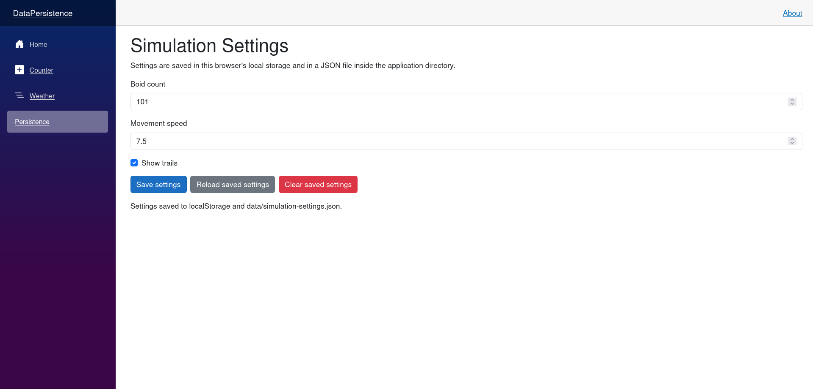

# Data Persistence

## Micro Goal

Understand how to persist application data beyond a component's lifetime, choose appropriate storage based on the data's lifetime and sensitivity, and implement basic save-and-load behavior in a Blazor application.

## Concepts Covered

- Component state versus persistent data
- Data lifetime and storage location
- Browser memory and component fields
- Browser storage: `localStorage` and `sessionStorage`
- JavaScript interop for browser APIs
- JSON serialization and deserialization
- Blazor services for managing persistent state
- HTTP API persistence
- Server-side persistence and databases
- Entity Framework Core as an introduction to database-backed storage
- Loading, saving, and deleting data
- Handling missing, malformed, or outdated stored data
- Asynchronous persistence operations
- Browser storage limitations and security considerations
- Choosing a persistence strategy based on application requirements

## Completion Criteria

- [ ] Explain the difference between component state and persistent data.
- [ ] Distinguish data that survives re-renders, component navigation, browser refreshes, and application restarts.
- [ ] Explain the differences between `localStorage` and `sessionStorage`.
- [ ] Use JavaScript interop or an appropriate Blazor storage integration to read and write browser storage.
- [ ] Serialize and deserialize a simple C# model as JSON.
- [ ] Implement save, load, and clear operations for a persistent setting.
- [ ] Handle missing or invalid stored data without crashing the application.
- [ ] Understand why browser storage is not a suitable source of truth for shared multi-user simulation state.
- [ ] Explain how an ASP.NET Core API can persist data on behalf of a Blazor frontend.
- [ ] Explain the role of a database and Entity Framework Core in server-side persistence.
- [ ] Use asynchronous methods for storage operations where appropriate.
- [ ] Choose a persistence strategy based on data ownership, lifetime, security, and sharing requirements.

## Lecture

### 1. What data persistence means

Data persistence means retaining data beyond the lifetime of the in-memory objects currently holding it.

A Blazor component can store data in a field or property:

```csharp
private int boidCount = 100;
```

This value exists in memory while the component instance exists. If the component is recreated, the field is initialized again. If the application or browser session ends, the in-memory value is not automatically preserved.

That is not necessarily a problem. Some state should be temporary. For example, the current value of a slider may only matter while a user is adjusting a simulation setting.

Other data may need to survive longer:

- A user's preferred simulation speed.
- A saved collection of simulation settings.
- A named simulation configuration.
- A simulation's saved initial state.
- A shared simulation's authoritative state.

These examples have different persistence requirements. A preference can often be stored locally in the browser. A saved simulation that must be available on another device needs storage beyond that browser. A shared simulation needs a common source of truth that multiple users can access.

The first question when choosing persistence is therefore not which storage technology to use. It is **how long the data must live, who owns it, and who needs to access it**.

### 2. Component state and persistent data

Blazor components manage state in fields and properties. That state can survive a component re-render, because rendering does not necessarily create a new component instance.

For example:

```csharp
private int boidCount = 100;

private void IncreaseBoidCount()
{
    boidCount += 10;
}
```

When a component event changes `boidCount`, Blazor can render the component again using the updated value. The re-render does not itself erase the field.

However, component state is not automatically durable. Navigating away and back may create a new component instance. A browser refresh also starts a new page execution context.

It helps to distinguish these lifetimes:

- **Re-render:** The existing component instance normally retains its fields.
- **Component recreation:** Instance fields are initialized again.
- **Browser refresh:** In-memory component state is lost.
- **Browser or application restart:** In-memory state is lost.
- **Cross-device access:** Local in-memory state and browser storage are not automatically available on another device.

Persistence moves selected data into a storage system whose lifetime is longer than the current component instance.

### 3. Choose storage based on the data's lifetime

Different storage mechanisms provide different lifetimes and sharing characteristics.

| Storage mechanism | Survives re-render | Survives refresh | Shared across users | Survives browser restart |
|---|---|---|---|---|
| Component field | Yes, for the same instance | No | No | No |
| In-memory service | Usually, while the service instance lives | Depends on app lifecycle | Depends on service lifetime and hosting model | No |
| `sessionStorage` | Yes | Yes, within the same tab session | No | Generally no |
| `localStorage` | Yes | Yes | No | Generally yes |
| Backend database | Yes | Yes | Yes, when access is authorized | Yes |

The table describes typical behavior, not an absolute guarantee for every application architecture. For example, a server-side in-memory service may be shared among connected users within one server process, but it is not durable and may not be shared across multiple server instances.

Use the simplest storage that satisfies the actual requirement.

### 4. Browser storage: `localStorage` and `sessionStorage`

Web browsers expose two common key-value storage APIs:

- `localStorage` retains values across page reloads and normally across browser restarts until the data is removed.
- `sessionStorage` retains values for the lifetime of a page session, generally associated with a browser tab.

Both store strings. They do not directly store C# objects.

A simple JavaScript example illustrates the APIs:

```javascript
localStorage.setItem("boidCount", "100");

const savedCount = localStorage.getItem("boidCount");

sessionStorage.setItem("displayMode", "Trails");
```

In a Blazor application, browser APIs must be accessed through JavaScript interop or an appropriate library. C# code cannot directly call `localStorage` as if it were a .NET collection.

Browser storage is useful for preferences, display settings, and other small pieces of client-owned data. It is not a shared database. Each browser profile maintains its own storage, so one user's saved values do not automatically appear for another user.

### 5. Access browser storage from Blazor

Blazor provides JavaScript interop through `IJSRuntime`. A component can inject it and invoke browser-side JavaScript functions.

For example, JavaScript could expose two functions:

```javascript
window.boidStorage = {
    save: (key, value) => localStorage.setItem(key, value),
    load: (key) => localStorage.getItem(key),
    remove: (key) => localStorage.removeItem(key)
};
```

A Blazor component could call those functions using `IJSRuntime`:

```csharp
await JS.InvokeVoidAsync(
    "boidStorage.save",
    "boidCount",
    "100");

string? savedValue = await JS.InvokeAsync<string?>(
    "boidStorage.load",
    "boidCount");
```

This example assumes that the JavaScript object is loaded and available to the page. The exact script placement depends on the Blazor hosting model and project template.

In a real application, do not duplicate JavaScript interop calls across every component. Encapsulate browser storage behind a service so components can ask for a value without needing to know the implementation details.

Also remember that browser APIs are only available when running in a browser. Some server-side rendering paths execute before browser interop is available, so storage reads and writes must occur at an appropriate point in the component lifecycle.

### 6. Store structured data with JSON

Real application state usually consists of more than one primitive value. A simulation configuration might include a boid count, movement speed, and whether trails are enabled.

Represent the configuration with a C# type:

```csharp
public sealed class SimulationSettings
{
    public int BoidCount { get; set; } = 100;
    public double MovementSpeed { get; set; } = 2.0;
    public bool ShowTrails { get; set; }
}
```

To persist this object as a string, serialize it to JSON:

```csharp
using System.Text.Json;

var settings = new SimulationSettings
{
    BoidCount = 150,
    MovementSpeed = 2.5,
    ShowTrails = true
};

string json = JsonSerializer.Serialize(settings);
```

To recover the object, deserialize the JSON:

```csharp
SimulationSettings? restored =
    JsonSerializer.Deserialize<SimulationSettings>(json);
```

The deserializer can return `null`, and malformed JSON can cause a `JsonException`. Production code should account for these cases rather than assuming every stored value is valid.

JSON is a serialization format, not a storage system. You still need to decide where the JSON string is stored: browser storage, a file, an API, or a database.

### 7. Build a persistence service

A persistence service gives the application one place to manage saving and loading. Components call the service rather than directly handling storage APIs.

For example, a service might expose methods such as:

```csharp
Task SaveSettingsAsync(SimulationSettings settings);
Task<SimulationSettings?> LoadSettingsAsync();
Task ClearSettingsAsync();
```

These methods express the intent of the operation without exposing the underlying storage mechanism.

An implementation could use browser storage, an HTTP API, or another provider. This separation makes the application easier to maintain and allows the storage implementation to change without rewriting every component.

For browser storage, a service can wrap `IJSRuntime` or a suitable browser-storage package. For backend persistence, it can call an ASP.NET Core API using `HttpClient`.

Register the service through dependency injection so components can request it. The registration and lifetime should match the chosen storage implementation and hosting model.

Avoid making a browser-storage service depend on browser APIs during server-side initialization. Defer browser operations until the browser runtime is available.

### 8. Save and load settings asynchronously

Storage operations should be modeled with asynchronous methods when they involve JavaScript interop, HTTP requests, or database operations.

A component might load settings during its initialization or after the browser becomes interactive, depending on the hosting model:

```csharp
private SimulationSettings settings = new();

private async Task SaveSettingsAsync()
{
    await settingsStore.SaveSettingsAsync(settings);
}

private async Task LoadSettingsAsync()
{
    SimulationSettings? saved =
        await settingsStore.LoadSettingsAsync();

    if (saved is not null)
    {
        settings = saved;
    }
}
```

This example assumes that `settingsStore` is an injected service implementing the shown methods.

Do not block asynchronous storage operations with `.Result` or `.Wait()` in component code. Use `await` so the operation can complete without unnecessarily blocking the execution flow.

Loading can fail. A browser may deny access to storage, a network request may fail, or stored JSON may be malformed. Handle expected failures appropriately and provide a sensible fallback when the application can safely continue without the saved value.

For example, if no settings have been saved, the component can retain its defaults rather than treating missing data as a fatal error.

### 9. Data persistence through an ASP.NET Core API

Browser storage is appropriate for local preferences, but it is not enough when data must be available to multiple users or devices.

A Blazor frontend can call an ASP.NET Core API to save and load data. The API becomes the boundary between the browser and server-side persistence.

A typical flow is:

1. The user changes simulation settings in a Blazor component.
2. The component calls an application service.
3. The service sends an HTTP request to an ASP.NET Core endpoint.
4. The API validates the request and applies the required business rules.
5. The backend stores the data in a database or another persistent system.
6. The API returns a response.
7. The Blazor component updates its UI based on the response.

The frontend should not connect directly to a database using database credentials embedded in browser-delivered code. The API keeps database access on the server and provides a controlled interface.

An API might expose endpoints such as:

- `GET /api/simulations` to retrieve available simulations.
- `GET /api/simulations/{id}` to retrieve one simulation.
- `POST /api/simulations` to create a simulation.
- `PUT /api/simulations/{id}` to update a simulation.

The actual routes and HTTP methods depend on the API contract. These are examples of a possible design, not requirements to implement every endpoint immediately.

### 10. Database-backed persistence

A database is appropriate when data must survive application restarts, be shared across users, support structured queries, or be managed consistently by a server.

For .NET applications, Entity Framework Core (EF Core) is a common object-relational mapper. It allows C# code to work with entity types and a database context while translating supported operations into database queries and updates.

A typical model might represent a saved simulation:

```csharp
public sealed class SavedSimulation
{
    public int Id { get; set; }
    public string Name { get; set; } = string.Empty;
    public int BoidCount { get; set; }
    public double MovementSpeed { get; set; }
}
```

A database context represents the session through which EF Core queries and saves entities. A `DbSet<SavedSimulation>` provides access to the saved simulation records.

The API can use the context to retrieve and save data. The Blazor component communicates with the API rather than using the context directly.

EF Core supports multiple database providers. The provider, schema, and deployment setup should be selected when the application's actual data requirements are clear. For this learning module, understanding the responsibility of each layer is more important than committing to a specific database too early.

### 11. Local preferences versus shared simulation state

The long-term Boids application has an important distinction between personal preferences and shared simulation data.

**Personal preferences** might include:

- Preferred display mode.
- Whether trails are visible.
- UI panel layout.
- A user's default movement-speed setting.

These can often be stored in browser storage if they only need to persist on that browser. If preferences should follow a user across devices, they may need server-side storage associated with that user's account.

**Shared simulation state** might include:

- The current authoritative simulation state.
- The simulation's configuration.
- A set of saved shared simulations.
- Events that users submit to affect the shared simulation.

Browser-local storage is not a reliable source of truth for this shared state. If two users independently modify their local copies, those changes do not automatically synchronize.

A shared simulation needs a server-side coordination mechanism so clients can receive a consistent view of the simulation and observe other users' interactions. Real-time communication is a separate concern from persistence. A persistent database can store durable data, while a real-time channel can distribute live updates; neither automatically replaces the responsibilities of the other.

We will address shared-state synchronization and real-time interaction in a later learning area. For now, learn how to persist a setting and how a Blazor client can request saved data from a backend.

### 12. Data integrity and security

Persisted data should not be trusted merely because the application previously wrote it. Browser storage can be edited by the user, removed by the browser, or contain outdated values from an older version of the application.

Validate data when it is loaded or submitted to a backend. Enforce server-side validation for data that affects shared state or other users. Client-side validation is useful for user experience, but it cannot enforce security by itself.

Do not store passwords, private credentials, or sensitive authorization data in ordinary browser storage. Browser storage is accessible to scripts running in the page, so a cross-site scripting vulnerability can expose its contents.

For server-side persistence, authorization rules must determine which user can read or modify each record. Knowing a record's identifier is not sufficient permission to access it.

Finally, consider data versioning. If the shape of a saved settings object changes in a later version of the application, older JSON may no longer deserialize or may not contain new properties. A robust design can detect invalid or outdated data and migrate it, discard it safely, or fall back to defaults.

## Challenge

Implement persistent simulation settings in a Blazor component using browser storage. Keep the implementation small and focus on save-and-load behavior rather than introducing a database or authentication system.

Your solution must satisfy all of the following requirements:

1. **Create a settings model:** Define a `SimulationSettings` type with a boid count, movement speed, and a Boolean display preference.
2. **Provide default values:** Initialize sensible defaults so the component can function when no saved settings exist.
3. **Implement a storage service:** Encapsulate browser-storage operations behind a service rather than scattering JavaScript interop calls throughout the component.
4. **Save settings:** Allow the user to save the current settings to browser storage as serialized JSON.
5. **Load settings:** Load saved settings and apply them to the component's state.
6. **Clear saved settings:** Provide an operation that removes the stored settings and restores the component's defaults.
7. **Handle missing data:** If no settings are stored, keep the defaults without throwing an exception.
8. **Handle invalid data:** Account for malformed JSON and invalid values without crashing the component.
9. **Use asynchronous operations:** Await JavaScript interop or other asynchronous storage calls.
10. **Verify persistence:** Save settings, refresh the page, and confirm that the settings are restored.
11. **Explain the storage choice:** State why browser storage is appropriate for local preferences but not authoritative shared simulation state.
12. **Keep responsibilities clear:** Separate the settings model, persistence service, and component UI logic. Do not add database persistence, authentication, or real-time synchronization yet.


