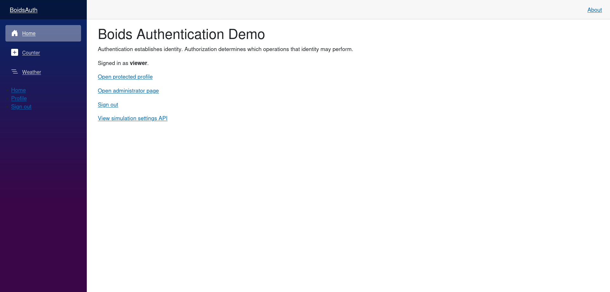

# Authentication & Authorization

## Micro Goal

Understand how authentication establishes a user's identity and authorization determines what that user can access. Learn how Blazor applications integrate with ASP.NET Core authentication, represent authenticated users, restrict UI and application operations, and protect user-specific data.

## Concepts Covered

- Authentication versus authorization
- Identity and claims
- `ClaimsPrincipal` and `ClaimsIdentity`
- Authentication state in Blazor
- `AuthenticationStateProvider`
- `AuthorizeView`
- The `[Authorize]` attribute
- Role-based and policy-based authorization
- Authentication and authorization in ASP.NET Core
- Sign-in and sign-out flows
- Cookie authentication and authentication state
- Securing API endpoints
- Authenticated HTTP requests
- Protecting user-specific data
- Authentication configuration and environment settings
- The limitations of client-side authorization
- Testing authenticated and unauthenticated behavior

## Completion Criteria

- [ ] Explain the difference between authentication and authorization.
- [ ] Explain how claims represent information about an authenticated user.
- [ ] Understand the purpose of `ClaimsPrincipal`, `ClaimsIdentity`, and `AuthenticationState`.
- [ ] Explain the role of `AuthenticationStateProvider` in Blazor.
- [ ] Use `AuthorizeView` to display different UI for authenticated and unauthenticated users.
- [ ] Understand how route authorization works in Blazor.
- [ ] Distinguish role-based authorization from policy-based authorization.
- [ ] Explain how ASP.NET Core authenticates HTTP requests and authorizes access to endpoints.
- [ ] Understand the purpose of sign-in and sign-out operations.
- [ ] Explain why hiding a UI element does not secure the corresponding backend operation.
- [ ] Understand how authentication affects API calls and user-specific data.
- [ ] Identify which authentication configuration depends on the application's hosting model.
- [ ] Explain how authentication and authorization could support the multi-user Boids simulation.

## Lecture

### 1. Authentication and authorization

Authentication and authorization are related but separate security concepts.

**Authentication** determines who a user is. It establishes an identity that the application can associate with subsequent requests or interactions.

**Authorization** determines what an authenticated identity is allowed to do. It evaluates whether the user has permission to access a resource or perform an operation.

For example, in a multi-user Boids simulation:

- Authentication identifies a connected user.
- Authorization determines whether that user can change simulation settings, create a simulation, or administer a shared session.
- The application can associate saved preferences or simulations with a particular user.
- The backend decides whether an incoming request is allowed to modify shared simulation state.

A user being authenticated does not automatically mean that the user is authorized to perform every operation.

An application can also allow certain operations without authentication. For example, it might allow anyone to view a public simulation while requiring sign-in to save personal configurations.

### 2. Identity and claims

After authentication, an application needs a representation of the user's identity.

In ASP.NET Core, a `ClaimsPrincipal` represents the user associated with a request or authentication state. It can contain one or more `ClaimsIdentity` instances, each of which contains claims describing that identity.

A claim is a piece of information represented by a type and a value. Examples include:

- A user's identifier.
- A display name.
- An email address.
- A role.
- A permission or other application-specific attribute.

Claims are not inherently proof that their values are trustworthy. They must come from a trusted authentication process or another validated source.

For example, application code might inspect the user's identity and claims:

```csharp
using System.Security.Claims;

ClaimsPrincipal user = /* authenticated principal */;

string? userId = user.FindFirst(ClaimTypes.NameIdentifier)?.Value;
string? displayName = user.Identity?.Name;

bool isAuthenticated = user.Identity?.IsAuthenticated == true;
```

This is illustrative code; the `ClaimsPrincipal` must come from the application's actual authentication state. Do not construct an identity from untrusted client-submitted values and treat it as authenticated.

The user identifier is especially important when working with personal data. A backend should determine the caller's identity from the validated authentication context, not trust a user ID supplied in a request body as proof of ownership.

### 3. Authentication state in Blazor

Blazor components often need to know whether a user is authenticated and which claims are available.

Blazor represents this information through `AuthenticationState`, which contains a `ClaimsPrincipal`. Components can access authentication state through Blazor's authentication services.

The `AuthenticationStateProvider` is the abstraction that supplies authentication state to Blazor components. A provider obtains or exposes the current state and can notify components when that state changes.

The exact implementation depends on the application's hosting and authentication model. For example, a server-side Blazor application using ASP.NET Core authentication may obtain identity information from the server's authenticated user context. A WebAssembly application typically needs a configured authentication mechanism to establish the user's identity.

The authentication state exposed to a component is useful for rendering decisions. It does not replace server-side validation of requests that access protected resources.

### 4. Displaying authenticated and unauthenticated UI

Blazor provides `AuthorizeView` to render different content depending on the user's authorization state.

For example:

```razor
<AuthorizeView>
    <Authorized>
        <p>You are signed in.</p>
    </Authorized>
    <NotAuthorized>
        <p>You are not signed in.</p>
    </NotAuthorized>
</AuthorizeView>
```

The `Authorized` section is displayed when the current authentication state satisfies the authorization requirement for the view. The `NotAuthorized` section is displayed otherwise.

This is useful for navigation menus, account controls, and features that should only be presented to authenticated users.

A role can also be used:

```razor
<AuthorizeView Roles="Administrator">
    <Authorized>
        <button>Manage simulations</button>
    </Authorized>
</AuthorizeView>
```

This example assumes the application has a trusted authentication system that supplies the relevant role and that the role is named `Administrator`.

The button's visibility is a UI behavior, not a security boundary. The operation behind it must also be protected by backend authorization.

### 5. Route authorization

Blazor applications often define pages using the `@page` directive. Authentication and authorization can affect which pages users are allowed to access.

A page can declare an authorization requirement:

```razor
@page "/account"
@attribute [Authorize]

<h1>Account</h1>

<p>This page requires an authenticated user.</p>
```

The `[Authorize]` attribute declares that the page requires authorization. For this to work, the application must have the appropriate authorization services, authentication state integration, and routing configuration.

Blazor's routing setup and authorization behavior depend on the application template and render mode. Some templates use an `AuthorizeRouteView` component to evaluate page authorization. Others may have different routing and endpoint arrangements.

A protected page should not be treated as a substitute for securing backend endpoints. Even if a page is restricted, a caller may attempt to invoke an API directly.

### 6. Role-based and policy-based authorization

Authorization can be expressed in several ways.

**Role-based authorization** grants access based on roles assigned to an identity. Typical roles might include `Administrator`, `Editor`, or `Viewer`.

For example, an endpoint might require an administrator role:

```csharp
app.MapPost("/api/simulations/{id:int}/settings", UpdateSettings)
   .RequireAuthorization(policy => policy.RequireRole("Administrator"));
```

The exact handler is omitted here; `UpdateSettings` represents the endpoint's application logic. The authorization requirement is enforced by ASP.NET Core when configured correctly.

**Policy-based authorization** expresses access requirements as named policies. A policy may require authentication, a particular claim, a role, or a more complex condition.

For example, a named policy could require a specific permission:

```csharp
builder.Services.AddAuthorization(options =>
{
    options.AddPolicy("CanManageSimulations", policy =>
    {
        policy.RequireAuthenticatedUser();
        policy.RequireClaim("permission", "simulations.manage");
    });
});
```

The policy can then be applied to an endpoint:

```csharp
app.MapPost("/api/simulations/{id:int}/settings", UpdateSettings)
   .RequireAuthorization("CanManageSimulations");
```

This assumes the authentication system issues a trusted `permission` claim with the specified value. The claim must be established by a trusted identity system, not accepted directly from arbitrary client input.

Roles are useful for broad categories of users. Policies are more flexible when access depends on specific permissions or conditions. Neither approach automatically implements resource ownership checks; an application may need to verify that a particular user owns or can modify a particular simulation.

### 7. Authentication in ASP.NET Core

Blazor authentication is closely connected to ASP.NET Core when the application uses server-side authentication or communicates with an ASP.NET Core backend.

ASP.NET Core authentication is configured through authentication schemes and handlers. A scheme identifies how a request is authenticated, such as through an authentication cookie or a bearer token.

A cookie-based application commonly uses a sign-in flow that establishes an authenticated session. Subsequent browser requests include the cookie, allowing the server to recover the user's authenticated identity.

A bearer-token-based API commonly receives an access token in the HTTP `Authorization` header. The backend validates the token before accepting the identity it represents.

These mechanisms are not interchangeable in every scenario. The right choice depends on the application's hosting model, client type, identity provider, and security requirements.

Authentication configuration commonly involves:

- Registering authentication services.
- Configuring the appropriate authentication scheme.
- Registering authorization services.
- Configuring middleware in the correct order.
- Applying authorization requirements to protected endpoints.

A typical ASP.NET Core pipeline includes authentication before authorization:

```csharp
app.UseAuthentication();
app.UseAuthorization();
```

The actual setup depends on the application's template and endpoint configuration. Follow the hosting model's required middleware and routing setup rather than copying these two lines into every project without context.

### 8. Sign-in and sign-out flows

Signing in establishes an authenticated session or obtains an authenticated identity through the application's configured authentication system. Signing out ends or removes the relevant session or authentication state.

A sign-in flow may involve:

1. The user initiates sign-in.
2. The application redirects to an identity provider or presents a configured sign-in mechanism.
3. The identity system authenticates the user.
4. The application receives and validates the resulting identity.
5. The application establishes or updates its authentication state.

The sign-out flow depends on the mechanism. A cookie-based application may clear the authentication cookie. An external identity provider may also have a separate sign-out flow.

Blazor components should not invent their own authentication state by setting a local Boolean to `true`. A Boolean can control UI, but it does not establish a trusted identity or cause the server to authenticate future requests.

Use the authentication system provided by the application's template and configured identity provider.

### 9. Protecting backend endpoints

The most important security principle is that **the backend must enforce authorization for every protected operation**.

A component might hide a button from unauthenticated users, but a caller can still construct an HTTP request manually. The API must verify authentication and authorization independently of the UI.

For example:

```csharp
app.MapDelete("/api/simulations/{id:int}", DeleteSimulation)
   .RequireAuthorization();
```

This requires an authenticated identity, assuming the application's authentication and authorization middleware are correctly configured.

However, requiring authentication alone does not determine whether the caller is allowed to delete the specific simulation identified by `id`. The handler or a resource-based authorization policy must also verify the relevant permission or ownership.

For user-specific data, the backend should derive the caller's identity from the authenticated request context and use it to scope the operation. It should not rely solely on a client-provided owner ID.

For the Boids application, the backend will eventually need to distinguish operations such as viewing a shared simulation, changing its shared state, and managing access to it. These requirements can be implemented later when the multi-user behavior is designed.

### 10. Authenticated API requests from Blazor

A Blazor frontend may communicate with an ASP.NET Core API that requires authentication.

The request must carry the appropriate authentication information for the chosen scheme. For a bearer-token API, this commonly means an access token in the `Authorization` header. For cookie-based authentication, the browser may send an applicable authentication cookie according to the application's origin, cookie, and request configuration.

A component should not blindly attach tokens or secrets to every outgoing request. Authentication handlers and configured HTTP clients should be used according to the application's security model.

The backend must validate the authentication information and authorize the requested operation. A client that cannot access an endpoint should handle the resulting response appropriately—for example, by prompting the user to sign in or displaying an access-denied message.

For browser-based applications, cross-origin requests, cookie policies, and cross-site request forgery protection may also affect how authenticated requests work. These concerns depend on the application's deployment and authentication configuration.

### 11. Protecting user-specific data

Authentication becomes particularly useful when the application stores data associated with individual users.

Examples include:

- Saved simulation configurations.
- Personal display preferences.
- Named simulations.
- User-specific simulation history.
- Permissions to manage or modify a shared simulation.

A typical server-side operation should identify the authenticated caller, determine which resource is being accessed, and verify that the caller has permission to perform the operation.

For example, retrieving saved configurations should return only the records the caller is allowed to see. Updating a configuration should check whether the caller owns it or has an appropriate permission.

This authorization must be enforced on the server. Hiding another user's configuration in the UI does not prevent a malicious caller from attempting to request it directly.

For the multi-user Boids simulation, user identity may eventually be useful for associating participants with a shared simulation and attributing interactions to individual users. The exact persistence and synchronization model will be designed later.

### 12. Hosting models and authentication differences

Blazor applications can use different hosting and rendering arrangements, and authentication details vary accordingly.

In server-side Blazor, components execute on the server. The application can use ASP.NET Core's server-side authentication context, but UI state and protected HTTP endpoints still have distinct security responsibilities.

In Blazor WebAssembly, application code executes in the browser. Browser-side state is not a trusted security boundary. Protected backend resources must validate authentication and authorization on the server.

Blazor Web Apps can combine server-side rendering, interactive server components, and WebAssembly components depending on their configuration. Authentication setup must account for the selected render modes and how requests reach protected endpoints.

The goal of this module is to understand the shared principles rather than implement every hosting model. When building the Boids application, the authentication mechanism will be chosen based on the architecture and the features actually needed.

### 13. Testing authentication and authorization

Authentication and authorization behavior should be tested independently from ordinary UI rendering.

Useful test cases include:

- An unauthenticated request to a protected endpoint is rejected or challenged as configured.
- An authenticated user can access an endpoint they are permitted to use.
- A user without a required role or permission is denied access.
- A user cannot modify another user's protected resource without authorization.
- Sign-out removes or invalidates the relevant authenticated session.
- Public endpoints remain accessible when intended.

Integration tests can configure test authentication schemes or test identities to exercise these cases without relying on real production accounts.

Tests should verify the actual backend response and resource behavior. A test that only checks whether a button is visible does not establish that the operation is secured.

## Challenge

Build a small authentication-aware Blazor application that demonstrates authenticated UI, route protection, and backend authorization concepts. Use the authentication mechanism supported by the chosen Blazor template; do not simulate authentication by toggling a Boolean.

Your solution must satisfy all of the following requirements:

1. **Identify authentication and authorization:** Include a short explanation in comments or the README describing the difference between the two.
2. **Configure authentication:** Use a supported ASP.NET Core authentication setup or the appropriate template integration. Do not trust client-created identity claims.
3. **Display authentication state:** Use `AuthorizeView` to show different UI for authenticated and unauthenticated users.
4. **Protect a page or route:** Configure an account or profile page that requires authentication.
5. **Demonstrate authorization:** Define a role or named policy and use it to restrict a specific operation or endpoint.
6. **Protect a backend operation:** Implement or configure an API endpoint that requires authorization. Do not rely only on hiding its UI control.
7. **Handle access denial:** Ensure unauthorized access produces the behavior appropriate to the application's hosting and authentication setup.
8. **Test access behavior:** Add tests for an unauthenticated request and an authenticated request, and include a test for a user who lacks the required permission if the chosen policy supports it.
9. **Keep the implementation focused:** Use a simple protected operation, such as retrieving or updating a simulation setting. A database, multi-user synchronization, and real-time event broadcasting are not required for this challenge.
10. **Document the setup:** Explain which authentication mechanism is used, how to run the application, and which parts of the application enforce authorization.

Understand how identity, authentication state, UI authorization, and backend authorization fit together. The challenge should use real framework authentication behavior.



