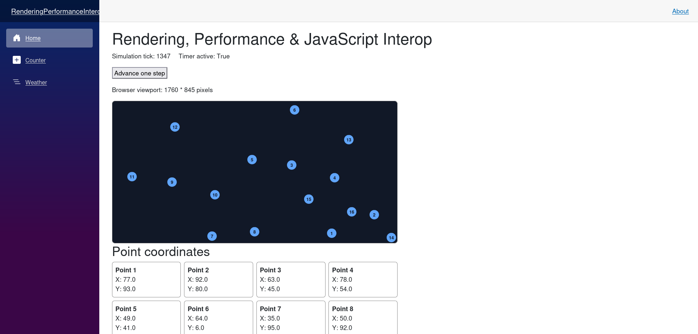

# Rendering, Performance & JavaScript Interop

## Micro Goal

Understand how Blazor components render and update, how component lifecycle events affect application behavior, how to identify common performance problems, and how to call browser JavaScript APIs from C# when browser-specific functionality is required.

## Concepts Covered

- Blazor rendering fundamentals
- Component lifecycle methods
- `OnInitialized` and `OnInitializedAsync`
- `OnParametersSet` and `OnParametersSetAsync`
- `OnAfterRender` and `OnAfterRenderAsync`
- `StateHasChanged`
- Event-driven rendering
- Rendering and component re-rendering
- Component disposal and cleanup
- `IDisposable` and `IAsyncDisposable`
- Avoiding unnecessary renders and repeated work
- Stable component identity with `@key`
- Efficient rendering of lists
- Asynchronous operations and UI responsiveness
- JavaScript interop with `IJSRuntime`
- Calling JavaScript functions from C#
- Calling C# methods from JavaScript with `DotNetObjectReference`
- JavaScript module imports
- Interop error handling and resource cleanup
- Browser-specific APIs and their limitations
- Measuring performance before optimizing

## Completion Criteria

- [ ] Explain what causes a Blazor component to render.
- [ ] Describe the purpose and execution order of the major component lifecycle methods.
- [ ] Use `OnInitializedAsync` for asynchronous initialization.
- [ ] Use parameter lifecycle methods when component parameters change.
- [ ] Explain when `StateHasChanged` is necessary and when Blazor already triggers a render.
- [ ] Use `@key` to preserve component identity in a changing list.
- [ ] Dispose of timers, subscriptions, and interop references when a component is removed.
- [ ] Identify common causes of unnecessary rendering and repeated computation.
- [ ] Use `IJSRuntime` to invoke a JavaScript function from a Blazor component.
- [ ] Import and invoke a JavaScript module.
- [ ] Expose a C# instance method to JavaScript when needed.
- [ ] Handle asynchronous interop calls and component disposal correctly.
- [ ] Explain why JavaScript interop should be used only when browser-specific functionality requires it.
- [ ] Build and run a component that combines lifecycle management, efficient rendering, and JavaScript interop.

## Lecture

### 1. How Blazor rendering works

Blazor builds a user interface from components. A component typically consists of Razor markup, C# logic, parameters, and state.

For example:

```razor
<h3>Simulation Status</h3>

<p>Boids: @boidCount</p>

<button @onclick="AddBoid">Add Boid</button>

@code {
    private int boidCount = 10;

    private void AddBoid()
    {
        boidCount++;
    }
}
```

When the component first renders, Blazor evaluates the markup and produces the corresponding UI. When the button is clicked, the event handler increments `boidCount`. Blazor then schedules a render so the displayed count can reflect the updated state.

A component does not need to manually manipulate the DOM to update ordinary UI state. Blazor calculates the changes needed to update the rendered output.

The exact rendering mechanism depends on the hosting and render mode. Interactive components can handle events and update UI state, while static server-rendered components do not provide ongoing interactive behavior unless interactivity is enabled.

The key principle is to update component state through C# and let Blazor manage the UI update process.

### 2. What triggers a render

Blazor normally schedules renders after component events and when relevant framework-managed operations complete. Parameter changes and cascading parameter changes can also cause a component to render.

For example:

```razor
<p>Count: @count</p>

<button @onclick="Increment">Increment</button>

@code {
    private int count;

    private void Increment()
    {
        count++;
    }
}
```

The button's event handler changes the state. Blazor automatically schedules a render after the event handler completes.

You generally do not need to call `StateHasChanged()` inside a normal Blazor event handler just to display the updated value.

However, state changes originating outside the normal component event flow may require an explicit render notification. Examples include callbacks from some external services, timers, or event subscriptions.

Understanding the source of a state change helps determine whether a manual render notification is necessary.

### 3. Component lifecycle

Blazor components have lifecycle methods that run at specific stages of their existence.

The major lifecycle methods are:

- `OnInitialized` and `OnInitializedAsync`: initialize component state.
- `OnParametersSet` and `OnParametersSetAsync`: respond to parameters supplied by a parent or routing system.
- `OnAfterRender` and `OnAfterRenderAsync`: perform work after the component has rendered.
- `Dispose` or `DisposeAsync`: release resources when the component is removed.

A simplified lifecycle sequence for a newly created component is:

1. The component is initialized.
2. Parameters are assigned.
3. Parameter lifecycle methods run.
4. The component renders.
5. After-render lifecycle methods run for interactive rendering.

Some lifecycle methods can run more than once. For example, a component can receive updated parameters, and rendering behavior differs between static server rendering and interactive rendering.

Do not assume every lifecycle method runs exactly once or that an interactive browser is available during initialization.

### 4. Initialization with `OnInitializedAsync`

Use `OnInitialized` for synchronous initialization and `OnInitializedAsync` for asynchronous initialization.

For example, a component might load simulation configuration from a service:

```razor
@page "/simulation"

<h3>Simulation</h3>

@if (configuration is null)
{
    <p>Loading configuration...</p>
}
else
{
    <p>Maximum boids: @configuration.MaxBoids</p>
}

@code {
    private SimulationConfiguration? configuration;

    protected override async Task OnInitializedAsync()
    {
        configuration =
            await ConfigurationService.GetConfigurationAsync();
    }
}
```

This example assumes that `ConfigurationService` is available through dependency injection and provides the specified method.

The component begins with `configuration` set to `null`, so it can display a loading state while the asynchronous operation is in progress.

When initialization completes, Blazor can render the resulting state. It is important to ensure that the markup can handle the state before the asynchronous operation completes.

Avoid performing expensive synchronous work on the UI execution path. If an operation is naturally asynchronous, use an asynchronous API rather than blocking on it.

### 5. Responding to parameter changes

`OnParametersSet` and `OnParametersSetAsync` are useful when a component's behavior depends on parameters supplied by its parent.

For example, a page might display a particular simulation based on an identifier in the route:

```razor
@page "/simulations/{SimulationId:int}"

<h3>Simulation @SimulationId</h3>

@if (simulation is null)
{
    <p>Loading simulation...</p>
}
else
{
    <p>Name: @simulation.Name</p>
}

@code {
    [Parameter]
    public int SimulationId { get; set; }

    private Simulation? simulation;

    protected override async Task OnParametersSetAsync()
    {
        simulation =
            await SimulationService.GetSimulationAsync(SimulationId);
    }
}
```

This example assumes that `SimulationService` is registered and provides the indicated method.

The important distinction is that initialization is associated with the component's creation, while parameter lifecycle methods respond to supplied parameters. A component may remain alive while its parameters change.

If the component needs to reload data for a new identifier, parameter lifecycle methods are a natural place to do so.

When asynchronous parameter loading can overlap, consider whether an older request could complete after a newer request and overwrite the latest state. Cancellation tokens or request-version checks can prevent stale results from being applied.

### 6. `OnAfterRenderAsync` and browser-dependent work

`OnAfterRender` and `OnAfterRenderAsync` run after the component has rendered interactively. They are useful for operations that require rendered elements or an available browser DOM.

For example, a component may need to initialize a JavaScript chart using a canvas element:

```razor
<canvas @ref="canvasElement"></canvas>

@code {
    private ElementReference canvasElement;

    protected override async Task OnAfterRenderAsync(bool firstRender)
    {
        if (firstRender)
        {
            await InitializeChartAsync(canvasElement);
        }
    }
}
```

This example assumes an `InitializeChartAsync` method that performs the necessary JavaScript interop.

The `firstRender` parameter is `true` when the component is rendering for the first time in that interactive component instance. It is useful for one-time initialization.

`OnAfterRenderAsync` does not automatically trigger another render when its returned task completes. If the method changes state that must be displayed, the component may need an explicit render notification.

Browser-dependent operations should not be performed as if the DOM were always available during initialization. In server-rendered applications, prerendering may execute components before an interactive browser connection exists.

### 7. Using `StateHasChanged`

`StateHasChanged()` tells Blazor that a component's state may have changed and that a render should be scheduled.

It is useful when state changes outside the normal framework event flow:

```razor
<p>Elapsed seconds: @elapsedSeconds</p>

@code {
    private int elapsedSeconds;

    private void OnExternalTick()
    {
        elapsedSeconds++;
        InvokeAsync(StateHasChanged);
    }
}
```

This example illustrates a notification coming from an external callback. `InvokeAsync` dispatches the work through Blazor's component synchronization context, which is important when a callback can occur outside the normal component execution context.

For a real timer, the component would also need to start the timer, subscribe to its callback, and dispose of it when the component is removed.

Do not call `StateHasChanged()` after every assignment by default. Blazor already schedules renders for common event and lifecycle operations. Redundant calls make code harder to reason about and can create unnecessary work.

Also avoid creating an unconditional render loop. For example, a component that calls `StateHasChanged()` from `OnAfterRenderAsync` on every render can repeatedly trigger itself.

### 8. Rendering lists and component identity with `@key`

A Blazor component often renders a collection of items:

```razor
@foreach (BoidViewModel boid in boids)
{
    <p>@boid.Id: (@boid.X, @boid.Y)</p>
}
```

When a collection changes, Blazor compares the new render output with the previous output. For lists that can be reordered, inserted into, or removed from, `@key` helps Blazor associate rendered elements and components with the correct data items.

```razor
@foreach (BoidViewModel boid in boids)
{
    <BoidDetails @key="boid.Id" Boid="boid" />
}
```

The key should be stable and unique among siblings. A boid's identifier is a more appropriate key than its current list index if boids can move or be reordered.

Without a suitable key, Blazor may reuse component instances according to their position in the render tree. That can lead to unexpected behavior when a list changes and components retain internal state.

Use `@key` when identity matters, not as a universal performance switch. It improves correspondence between data items and rendered elements or components.

### 9. Component disposal and resource cleanup

Components sometimes create resources that outlive a single method call, such as timers, event subscriptions, cancellation sources, or JavaScript references.

Those resources should be released when the component is removed.

A component can implement `IDisposable` for synchronous cleanup or `IAsyncDisposable` for asynchronous cleanup.

For example:

```razor
@implements IDisposable

<p>Elapsed seconds: @elapsedSeconds</p>

@code {
    private readonly System.Timers.Timer timer = new(1000);
    private int elapsedSeconds;

    protected override void OnInitialized()
    {
        timer.Elapsed += OnTimerElapsed;
        timer.Start();
    }

    private void OnTimerElapsed(
        object? sender,
        System.Timers.ElapsedEventArgs args)
    {
        _ = InvokeAsync(() =>
        {
            elapsedSeconds++;
            StateHasChanged();
        });
    }

    public void Dispose()
    {
        timer.Stop();
        timer.Elapsed -= OnTimerElapsed;
        timer.Dispose();
    }
}
```

This illustrates the core lifecycle principle, but production timer code should also consider synchronization, exception handling, and whether the timer can overlap callbacks. The important point is that the component removes its event handler and disposes of the timer.

Failure to unsubscribe can keep objects alive longer than expected, trigger callbacks after the component has been removed, or cause unexpected UI work.

Dispose resources the component owns. Do not dispose a shared service or resource owned by the dependency injection container unless its ownership contract explicitly requires that behavior.

### 10. Common causes of poor rendering performance

Rendering performance can be affected by more than the amount of Razor markup. Common causes include:

- Recomputing expensive values during every render.
- Rendering very large collections of components.
- Repeatedly loading the same data.
- Performing expensive synchronous work during event handling.
- Creating and disposing large numbers of temporary objects.
- Triggering excessive render notifications.
- Running expensive calculations on the same execution path responsible for UI responsiveness.
- Repeatedly invoking JavaScript interop for work that could be performed in a single call.

For example, if a component recalculates hundreds of boid positions inside markup expressions, those calculations may run again whenever the component renders.

A better design separates simulation updates from rendering. Update the model at a deliberate cadence, store the resulting state, and render the current state rather than recalculating the entire simulation as a side effect of producing markup.

Optimization should be based on measured behavior. First identify where time is being spent, then make a targeted change and verify that it improves the relevant metric.

### 11. Large collections and virtualization

Rendering a large list of components can be expensive because the browser and Blazor must manage many elements and component instances.

When the UI only needs to show a visible subset of a large collection, virtualization can reduce rendering work. Blazor provides the `Virtualize<TItem>` component for rendering visible items from a larger collection.

For example:

```razor
<Virtualize Items="boids" Context="boid">
    <BoidDetails @key="boid.Id" Boid="boid" />
</Virtualize>
```

This example assumes that `boids` is a suitable collection and `BoidDetails` is a component with a `Boid` parameter.

Virtualization is useful for long lists where only a portion of the items is visible at once. It is not necessarily appropriate for a simulation canvas that must visually represent every boid simultaneously.

For a Boids simulation, a canvas or another rendering-oriented approach may be more appropriate than creating a full component for each boid. The correct choice depends on the number of boids, update frequency, rendering requirements, and measured performance.

### 12. JavaScript interop and `IJSRuntime`

Blazor allows C# code to call JavaScript through the `IJSRuntime` service.

JavaScript interop is useful when functionality depends on browser APIs or a JavaScript library. Examples include:

- Reading browser dimensions.
- Working with canvas drawing APIs.
- Accessing browser storage.
- Listening to certain DOM events.
- Using an existing JavaScript visualization library.

If a task can be implemented cleanly with ordinary C# and Blazor components, JavaScript interop is not automatically necessary. It should be introduced when it provides access to browser capabilities or libraries that C# alone does not directly provide.

Inject `IJSRuntime` into a component:

```razor
@inject IJSRuntime JS

<button @onclick="ShowMessage">Show Message</button>

@code {
    private async Task ShowMessage()
    {
        await JS.InvokeVoidAsync(
            "alert",
            "Hello from Blazor");
    }
}
```

The runtime invokes the browser's JavaScript `alert` function. The call is asynchronous because JavaScript interop crosses a runtime boundary and may involve communication between .NET and JavaScript.

Use the appropriate interop method based on the expected return value:

- `InvokeVoidAsync` when no return value is needed.
- `InvokeAsync<T>` when JavaScript returns a value of type `T`.

JavaScript interop can fail if the browser context is unavailable or the JavaScript function cannot be found. Handle failures where appropriate, and avoid treating browser interop as an ordinary synchronous C# method call.

### 13. JavaScript modules

For maintainable applications, place JavaScript functions in module files instead of adding every function to a global namespace.

For example, create `wwwroot/js/simulation.js`:

```javascript
export function getViewportSize() {
    return {
        width: window.innerWidth,
        height: window.innerHeight
    };
}
```

Import the module from a Blazor component:

```razor
@implements IAsyncDisposable
@inject IJSRuntime JS

<p>Viewport: @viewportWidth x @viewportHeight</p>

<button @onclick="ReadViewport">Read Viewport</button>

@code {
    private IJSObjectReference? module;
    private int viewportWidth;
    private int viewportHeight;

    protected override async Task OnAfterRenderAsync(bool firstRender)
    {
        if (firstRender)
        {
            module = await JS.InvokeAsync<IJSObjectReference>(
                "import",
                "./js/simulation.js");
        }
    }

    private async Task ReadViewport()
    {
        if (module is null)
        {
            return;
        }

        ViewportSize size =
            await module.InvokeAsync<ViewportSize>("getViewportSize");

        viewportWidth = size.Width;
        viewportHeight = size.Height;
    }

    public async ValueTask DisposeAsync()
    {
        if (module is not null)
        {
            try
            {
                await module.DisposeAsync();
            }
            catch (JSDisconnectedException)
            {
                // The browser connection may already be gone.
            }
        }
    }

    private sealed class ViewportSize
    {
        public int Width { get; set; }
        public int Height { get; set; }
    }
}
```

This example assumes that `wwwroot/js/simulation.js` exists and that the component is running interactively. The path is relative to the application's web root.

The component imports the module after its first interactive render, calls the exported function, and deserializes its result into a C# object.

The module reference is disposed when the component is removed. In server-interactive scenarios, a browser connection may already be gone when cleanup occurs, so JavaScript interop disposal should account for disconnection where appropriate.

For a simple viewport example, the button explicitly requests the dimensions. A real responsive component might instead register a JavaScript event listener and notify .NET when the viewport changes.

### 14. Calling C# from JavaScript

Interop can also work in the opposite direction: JavaScript can invoke a .NET method exposed by a component.

This can be useful when a browser event originates in JavaScript and C# needs to react to it.

For example, a component might expose a method to receive a click coordinate:

```razor
@implements IDisposable
@inject IJSRuntime JS

<p>Last click: (@clickX, @clickY)</p>

@code {
    private int clickX;
    private int clickY;
    private DotNetObjectReference<ClickReceiver>? objectReference;

    protected override async Task OnAfterRenderAsync(bool firstRender)
    {
        if (firstRender)
        {
            objectReference =
                DotNetObjectReference.Create(new ClickReceiver(UpdateClick));
            await JS.InvokeVoidAsync(
                "registerClickReceiver",
                objectReference);
        }
    }

    private void UpdateClick(int x, int y)
    {
        clickX = x;
        clickY = y;
        _ = InvokeAsync(StateHasChanged);
    }

    public void Dispose()
    {
        objectReference?.Dispose();
    }

    private sealed class ClickReceiver
    {
        private readonly Action<int, int> callback;

        public ClickReceiver(Action<int, int> callback)
        {
            this.callback = callback;
        }

        [JSInvokable]
        public void ReceiveClick(int x, int y)
        {
            callback(x, y);
        }
    }
}
```

This is an illustrative sketch of the .NET callback concept, not a complete drop-in implementation: a production version must define the JavaScript registration function, correctly expose and invoke the .NET callback, and unregister the listener when the component is disposed. The JavaScript side typically invokes the .NET object reference's `invokeMethodAsync` method with the name of a `[JSInvokable]` method.

A `DotNetObjectReference` holds a reference that JavaScript can use to call into .NET. It must be disposed when it is no longer needed to avoid retaining .NET objects unnecessarily.

This capability is relevant to browser events that are not conveniently represented by a normal Blazor event handler. Prefer native Blazor event handling when it meets the requirement, because it generally needs less interop code.

### 15. Interop performance and failure handling

Every JavaScript interop call has overhead. In server-interactive Blazor, a call may cross the network connection between the browser and the server. In WebAssembly, calls cross the .NET/JavaScript runtime boundary.

For high-frequency operations, avoid one interop call per small unit of work if a single batched call would be sufficient.

For example, a simulation with hundreds of boids should not necessarily make a separate C#-to-JavaScript call for every coordinate on every frame. A more efficient approach may pass a batch of position data or let JavaScript perform the rendering after receiving updated state.

Interop should also handle cases where the component has been removed or the browser connection has ended. Depending on the hosting model, an interop call may fail with a `JSException`, `JSDisconnectedException`, or another relevant exception.

Do not suppress all interop errors indiscriminately. Handle expected lifecycle failures and allow unexpected errors to be diagnosed.

### 16. Rendering strategy for the Boids simulation

The Boids simulation introduces a performance problem that ordinary form-based UI does not: many moving entities may need to update and render frequently.

A reasonable conceptual separation is:

- **Simulation logic:** Computes boid positions and velocities.
- **State management:** Holds the current simulation state and coordinates updates.
- **Rendering:** Displays the current state in the browser.
- **User interaction:** Captures configuration changes and user input.

The best implementation depends on the number of boids, update rate, and whether the simulation must be shared across users. C# may be suitable for simulation logic, while JavaScript and canvas may be suitable for high-frequency browser rendering. Another option is to keep more of the simulation in C# and render through Blazor components when the workload is modest.

Because the long-term application will allow multiple users to interact with a shared simulation, the rendering model will eventually need to distinguish local UI updates from authoritative shared state and remote interaction events. That architecture is a later concern; this module establishes the rendering and interop fundamentals needed to evaluate those choices.

### 17. Measure before optimizing

Performance work should be driven by evidence rather than assumptions.

Useful measurements include:

- Time taken to update the simulation model.
- Time spent rendering.
- Number of components rendered.
- Frequency of state updates.
- JavaScript interop call count and duration.
- Browser frame rate and responsiveness.
- Memory growth over time.

Start with a working implementation and measure it. If a component is slow, identify whether the bottleneck is calculation, rendering, interop, or another dependency. Optimize the actual bottleneck, then measure again.

The goal is not to avoid all re-renders or JavaScript interop. It is to ensure that each operation is necessary, appropriately scoped, and efficient enough for the application's requirements.

## Challenge

Build a small interactive Blazor component that displays a collection of moving points, manages its lifecycle correctly, and uses JavaScript interop for one browser-specific operation.

Your solution must satisfy all of the following requirements:

1. **Create an interactive component:** Display a set of points with X and Y coordinates, along with a control that updates their positions.
2. **Use lifecycle methods:** Initialize component state appropriately and explain why initialization belongs in the chosen lifecycle method.
3. **Handle parameter changes:** Create a child component that accepts a parameter, and ensure its displayed state responds correctly when the parent supplies a new value.
4. **Use rendering correctly:** Allow ordinary Blazor event handlers to trigger UI updates without adding unnecessary `StateHasChanged()` calls.
5. **Use stable identity:** Render the points as a collection and use `@key` with a stable identifier.
6. **Implement cleanup:** Use a timer or subscription to trigger periodic updates, and dispose of it when the component is removed.
7. **Use JavaScript interop:** Create a JavaScript module that reads the browser viewport dimensions and invoke it from a Blazor component.
8. **Respect lifecycle constraints:** Import the JavaScript module only when interactive browser execution is available, and dispose of the module reference when appropriate.
9. **Handle interop errors:** Account for expected failures caused by component disposal or browser disconnection without silently suppressing unrelated errors.
10. **Avoid unnecessary work:** Keep simulation updates separate from markup rendering, and avoid repeated expensive calculations during ordinary renders.
11. **Explain the design:** In comments or accompanying notes, explain which operations belong in C#, which require JavaScript, and why the component uses its chosen lifecycle and cleanup approach.
12. **Verify behavior:** Run the application, test the interaction manually, and confirm that periodic updates stop after the component is removed.



