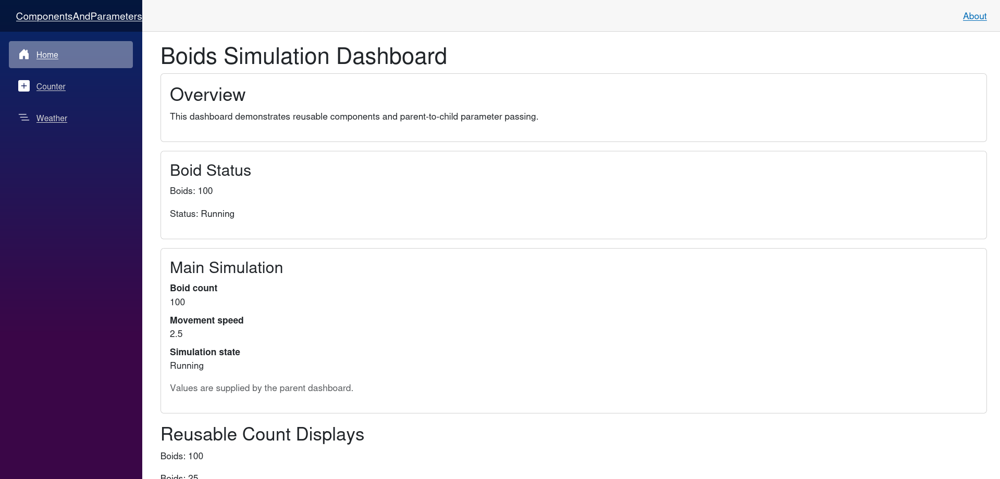

# Components & Parameters

## Micro Goal

Learn how to build reusable Blazor components, pass data between components through parameters, compose components into larger interfaces, and keep each component responsible for a clear part of the UI.

## Concepts Covered

- Razor component files (`.razor`)
- Component markup and C# code
- Component composition
- Rendering child components
- Component parameters with `[Parameter]`
- Required parameters
- Passing values from parent to child
- One-way data flow
- Strongly typed parameters
- `RenderFragment` and `ChildContent`
- Component reuse and separation of responsibilities
- Component naming and file organization
- Component-local state versus parameters
- Why child components should not directly modify parent-owned state

## Completion Criteria

- [ ] Explain what a Blazor component is and how a `.razor` file combines markup and C#.
- [ ] Create a reusable component and render it from another component.
- [ ] Define parameters with `[Parameter]`.
- [ ] Pass string, numeric, Boolean, and object values from a parent to a child.
- [ ] Use required parameters where a component cannot function without a value.
- [ ] Explain the difference between a parameter and component-local state.
- [ ] Compose several small components into a larger page.
- [ ] Use `ChildContent` to allow a component to render supplied markup.
- [ ] Avoid duplicating markup when the same UI pattern appears multiple times.
- [ ] Complete the challenge with clear component responsibilities and correct parameter usage.

## Lecture

### 1. What is a Blazor component?

A Blazor component is a reusable unit of UI. It can contain markup, C# logic, parameters, and state. Components can represent anything from a small status label to an entire page.

Blazor components are typically defined in `.razor` files. A Razor file combines HTML-like markup with Razor syntax and C# expressions.

For example, create a file named `BoidStatus.razor`:

```razor
<h3>Boid Status</h3>
<p>The simulation is running.</p>
```

This component renders a heading and a paragraph. To display it from another Razor component, use its component name as a tag:

```razor
<BoidStatus />
```

Component names conventionally use PascalCase and usually match their file names. Blazor resolves the component through its namespace and available imports.

A component is more than a fragment of HTML. It can receive data, respond to events, render conditionally, and contain other components. This makes components the primary building blocks of a Blazor interface.

### 2. Component composition

A page does not need to contain all its markup and logic itself. It can be composed from smaller components, each responsible for a specific part of the interface.

Imagine a Boids simulation page containing a title, a status display, and a control panel:

```razor
<h1>Boids Simulation</h1>

<BoidStatus />
<SimulationControls />
```

Here, `BoidStatus` and `SimulationControls` are separate components. The page coordinates them without needing to contain all their implementation details.

Component composition provides several benefits:

- **Reuse:** The same component can appear in multiple places.
- **Separation of responsibilities:** Each component focuses on one UI concern.
- **Maintainability:** Changes to a component can be made without rewriting the entire page.
- **Readability:** A page's markup communicates its structure at a glance.

A useful rule is to extract a component when a UI element has a clear responsibility, is repeated, or benefits from being independently understandable. Avoid splitting every individual HTML element into a separate component without a reason.

### 3. Parameters: passing data into a component

A component parameter lets a parent supply a value to a child component.

Suppose a status component should display different messages depending on the simulation state. Instead of hardcoding the message, define a parameter:

```razor
<p>@Message</p>

@code {
    [Parameter]
    public string Message { get; set; } = string.Empty;
}
```

The `[Parameter]` attribute marks `Message` as a value that can be supplied by the parent.

The parent can now use the component with different values:

```razor
<BoidStatus Message="Simulation running" />

<BoidStatus Message="Simulation paused" />
```

Each component instance receives its own parameter value. The first renders the running message, while the second renders the paused message.

Parameters make components configurable without duplicating their markup. The component defines how the information is displayed, while the parent decides which information to provide.

### 4. Strongly typed parameters

Parameters are ordinary C# properties, so they can use any appropriate type—not just strings.

For example, a Boids status component might need the current boid count and whether the simulation is running:

```razor
<div class="boid-status">
    <p>Boids: @BoidCount</p>
    <p>Status: @(IsRunning ? "Running" : "Paused")</p>
</div>

@code {
    [Parameter]
    public int BoidCount { get; set; }

    [Parameter]
    public bool IsRunning { get; set; }
}
```

The parent supplies the values:

```razor
<BoidStatus BoidCount="100" IsRunning="true" />
```

For Boolean and numeric parameters, Razor interprets the values according to the parameter's type. When a parameter should receive a C# expression rather than a literal, use `@`:

```razor
<BoidStatus BoidCount="@currentBoidCount"
            IsRunning="@isSimulationRunning" />
```

Assuming the parent defines `currentBoidCount` and `isSimulationRunning`, the child receives their current values.

Strongly typed parameters make the component contract clearer. An `int` count is preferable to a string containing a number because the compiler can enforce the intended type and the component can perform numeric operations directly.

### 5. Required parameters

Some components cannot function correctly without certain inputs. A required parameter expresses that requirement.

```razor
<h3>@Title</h3>
<p>@Description</p>

@code {
    [Parameter, EditorRequired]
    public string Title { get; set; } = string.Empty;

    [Parameter]
    public string Description { get; set; } = string.Empty;
}
```

`[EditorRequired]` tells supporting tooling to warn when a component is used without the parameter. It is a design-time aid; it does not itself guarantee that a value will be supplied at runtime.

The parent should provide the required title:

```razor
<InfoPanel Title="Simulation Settings"
           Description="Configure the simulation." />
```

For a component whose correct operation genuinely depends on a value, marking the parameter as required helps communicate that contract. Still choose sensible defaults where a value is optional.

### 6. Passing objects as parameters

Parameters can also receive objects. This is useful when several related values belong together.

For example, define a model:

```csharp
public class SimulationSummary
{
    public int BoidCount { get; set; }
    public double AverageSpeed { get; set; }
    public bool IsRunning { get; set; }
}
```

A component can accept the model as one parameter:

```razor
@if (Summary is not null)
{
    <p>Boids: @Summary.BoidCount</p>
    <p>Average speed: @Summary.AverageSpeed</p>
    <p>Status: @(Summary.IsRunning ? "Running" : "Paused")</p>
}

@code {
    [Parameter, EditorRequired]
    public SimulationSummary? Summary { get; set; }
}
```

The parent creates and supplies the object:

```razor
<SimulationSummaryPanel Summary="@summary" />
```

The parent must define `summary` with the appropriate type. The null check allows the component to handle the case where no summary is available.

Object parameters help group related information and reduce long lists of individual parameters. However, do not create a model solely to combine two simple values when separate parameters would be clearer.

### 7. One-way data flow

A useful component design is to let the parent own data and pass values down to children through parameters.

For example, the parent owns the boid count:

```razor
<BoidCountDisplay Count="@boidCount" />

@code {
    private int boidCount = 100;
}
```

The child displays the count:

```razor
<p>Current boids: @Count</p>

@code {
    [Parameter]
    public int Count { get; set; }
}
```

The parent owns the value; the child receives it for rendering. If the parent changes `boidCount` and rerenders, the child receives the updated parameter value.

Avoid treating a parameter as independently owned child state. If the child directly changes its parameter property, it can create confusing behavior because the parent remains the owner and may supply the original value again during a later render.

For example, this is not a good way for a child to request a change:

```csharp
// Avoid using a parameter as child-owned mutable state.
Count++;
```

If a child needs to request that the parent change a value, use an event callback. That pattern will be covered in the Events & Data Binding module.

### 8. Parameters versus component-local state

A parameter is supplied from outside the component. Component-local state is managed by the component itself.

For example, a reusable disclosure panel might receive its heading as a parameter but track whether it is expanded internally.

```razor
<h3>@Title</h3>

@if (isExpanded)
{
    <p>Additional details are visible.</p>
}

<button @onclick="ToggleExpanded">
    @(isExpanded ? "Collapse" : "Expand")
</button>

@code {
    [Parameter]
    public string Title { get; set; } = string.Empty;

    private bool isExpanded;

    private void ToggleExpanded()
    {
        isExpanded = !isExpanded;
    }
}
```

The parent chooses the title. The component manages its own expanded state.

This distinction helps determine where a value belongs:

- Use a parameter when the parent supplies the value.
- Use local state when the component owns the value and its lifecycle.
- Use an event callback when the child needs to request a change to parent-owned data.

Not every value needs to be shared across the application. Keeping state close to the component that owns it makes components easier to understand and reuse.

### 9. Rendering child content with `RenderFragment`

Some components need to provide a layout or wrapper while allowing the parent to supply the content inside it.

Blazor supports this through `RenderFragment`. The conventional parameter name for the default child content is `ChildContent`.

For example, create `Panel.razor`:

```razor
<section class="panel">
    @ChildContent
</section>

@code {
    [Parameter]
    public RenderFragment? ChildContent { get; set; }
}
```

A parent can supply arbitrary markup between the component tags:

```razor
<Panel>
    <h3>Simulation Information</h3>
    <p>The simulation contains 100 boids.</p>
</Panel>
```

The parent supplies the content, while the panel controls the surrounding structure.

This pattern is useful for cards, panels, modal layouts, and other wrappers whose content changes depending on where they are used.

A `RenderFragment` represents renderable content rather than a string. That means the parent can provide markup and nested components, not merely text.

### 10. Component organization

As an application grows, organizing components by responsibility becomes important.

For example:

```text
Components/
├── Layout/
├── Pages/
└── Simulation/
    ├── BoidStatus.razor
    ├── BoidCountDisplay.razor
    ├── SimulationControls.razor
    └── SimulationSummaryPanel.razor
```

This is an illustrative organization, not a required directory structure. The appropriate layout depends on the project template and the scale of the application.

For the Boids project, grouping simulation-specific components together can make the UI easier to navigate. General-purpose components can remain in a shared components area.

A component should have a clear responsibility. For example:

- `BoidStatus` displays the current status.
- `BoidCountDisplay` displays a count.
- `SimulationControls` groups controls.
- A page composes these components into a complete view.

Avoid making one large component responsible for every page, display, form, and simulation operation. Also avoid creating excessive tiny components that obscure rather than clarify the structure.

### 11. Component reuse in the Boids simulation

Imagine the simulation UI needs to display the boid count in a header and in a statistics panel. A reusable component can render that value consistently in both places.

```razor
<p class="boid-count">Boids: @Count</p>

@code {
    [Parameter]
    public int Count { get; set; }
}
```

The parent can use it more than once:

```razor
<BoidCountDisplay Count="@boidCount" />

<aside>
    <BoidCountDisplay Count="@boidCount" />
</aside>
```

Both instances receive the value supplied by the parent. This avoids duplicating the rendering logic and gives the count display one implementation.

Later, the simulation may receive state updates from a service or backend. The same component can continue to display the count; its responsibility does not need to change just because the source of the data changes.

That separation between the source of a value and the component that renders it is an important foundation for larger interactive applications.

## Challenge

Build a small component-based Blazor interface for a Boids simulation dashboard. Focus on component composition and parameters; do not implement the simulation engine or interactive event handling yet.

Your solution must satisfy all of the following requirements:

1. **Create a status component:** Implement `BoidStatus.razor` with parameters for the boid count and whether the simulation is running.
2. **Create a summary component:** Implement `SimulationSummary.razor` that accepts a title and displays a summary of the simulation.
3. **Use strongly typed parameters:** Use appropriate types such as `int`, `bool`, and `string` rather than representing every value as text.
4. **Use a required parameter:** Mark a parameter that is essential to a component with `[EditorRequired]`.
5. **Create a parent page:** Compose the status and summary components on one page, supplying different parameter values where appropriate.
6. **Reuse a component:** Render the same component more than once with different values to demonstrate reusability.
7. **Create a content wrapper:** Implement a `Panel.razor` component that uses `RenderFragment` through a `ChildContent` parameter.
8. **Supply child content:** Use the panel to display markup supplied by the parent, including a heading and descriptive text.
9. **Separate parameters from local state:** Include one component-local value that is not supplied by the parent, and explain why it belongs to the component.
10. **Keep responsibilities clear:** Components should render their own portion of the UI rather than duplicating the entire dashboard in each component.


